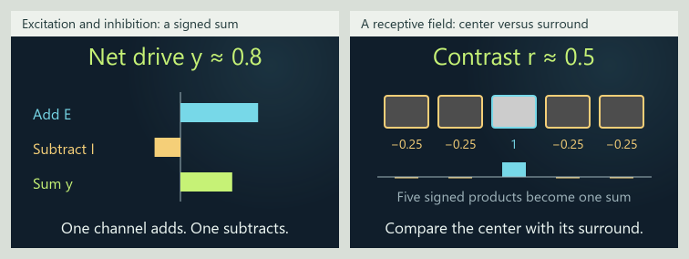
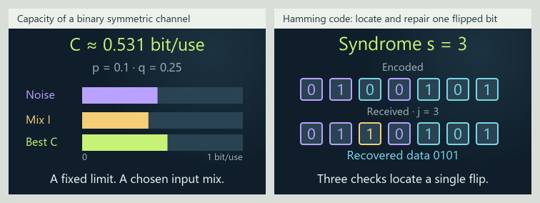
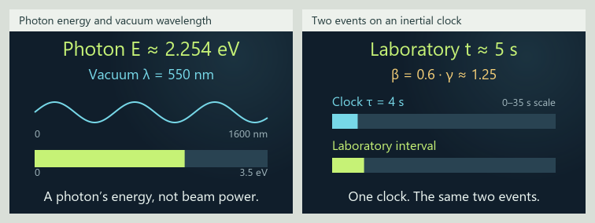

# Mathematical Expression Atlas

A visual field notebook for learning mathematics as a language of description.
Change an input, follow it through a story and formula, and see its effect in a
shape or graph. This branch prepares 0.34.0 with 148 draft lessons. The newest
six connect signed neural inputs and spatial receptive fields, noisy binary
communication and Hamming error correction, photon energy and relativistic
clock intervals. Each fills a roadmap gap through the existing shared playground.

The branch adds 87 lessons to the 61-card published baseline. It now contains
744 original examples, 2,879 numeric fixtures, 892 written exports, 303 declared
views and 148 MathML definitions. Sixty-four continuation lessons use twenty
explicit local families. Earlier number/geometry, inference, algebra, dynamics,
order and modeling checkpoints retain their own records and source proofs.

**[Open the live atlas](https://ppeck.me/mathcards/)** ·
[Project story](https://ppeck.me/projects/mathematical-expression-atlas/) ·
[Release history](CHANGELOG.md)

The live site remains on 0.33.0 while this expansion is reviewed on its separate
branch. A local branch build does not publish it.

The release version comes from [package.json](package.json). The generated
[build manifest](dist/build-manifest.json) records built card and example counts,
source hash and review status; [content/cards/](content/cards/) contains the
canonical lessons. Dated validation records describe the release they tested.



[Connected compact scenes](docs/presentation-0-34-signal-physics/neural-bridge-compact-scenes.png)



[Connected compact scenes](docs/presentation-0-34-signal-physics/information-bridge-compact-scenes.png)



[Connected compact scenes](docs/presentation-0-34-signal-physics/physics-bridge-compact-scenes.png)

These are static renders of the actual model artwork. The
[142-card number/geometry checkpoint](docs/INSIGHT_EXPANSION_MATRIX_0_34_0.md)
retains its earlier boards. Browser and phone qualification remain open.

## Explore

- Browse the eight atlas territories or search the collection.
- Search the 18-subject book inventory and distinguish available introductions
  from preparation and planned lessons.
- Follow a real-life story into its calculation and visual. Geometry and Graph
  share the same inputs; selected lessons also have Spatial views.
- Look up unfamiliar words and symbols in the searchable reference, then open
  the cards that use them.
- Put modules side by side, compare saved readings and keep private notes.

Stories, models, views, reference entries and map placement are separate
modules. Shared controls, animation timing, paced numbers and saved-state
contracts let the collection grow without rebuilding its interface.

## Run it

Use the live link above, or open `START_HERE.html` after downloading the repository.
That single file includes the app and works offline without an account or API key.

For source development, use Node.js 22 and Python 3.11:

```sh
npm ci --ignore-scripts
python -m pip install -r requirements-checks.txt
python tools/build.py
npm run check:format
python tools/check_source.py
npm run check:scenes
node --test --test-concurrency=2 tests/*.test.mjs
python tools/check.py
python -m http.server 4173 --directory src
```

Open `http://localhost:4173/`. The bounded test concurrency keeps the startup
budget measurement from competing with many simultaneous reference compilers.
To make a standalone ZIP, run `python tools/package.py`. Prettier is a pinned
development tool; the published app has no npm runtime dependency.
`npm run format` covers the declared incremental scope, excluding generated and
vendored files. `npm run measure:startup` runs three sequential background Node
measurements after a completed build; it does not launch a browser. Add
`--profile --runs=5` to the underlying Node command for five fixed attempts,
per-script CPU diagnostics and the separate built-prefix comparison. Failed
attempts remain in the JSON report and make the command fail.

## Contribute a lesson

Edit canonical records in `content/` and add the model, connected story,
representations and reference entries through the shared playground contract.
Rebuild and commit generated files alongside source changes. CI rejects drift
in the offline app, index, formula projection and written exports before publishing.
Every validated push to `main` updates the hosted demo automatically.

The build-only `tools/reference_authoring.cjs` validator checks definition IDs,
related-definition links and definition source keys before the reference is
projected. These editorial links name indexed definitions, not lesson slugs;
actual card-use links remain separately derived from canonical evidence.

| Guide | Purpose |
|---|---|
| [Architecture](docs/ARCHITECTURE.md) | Source layout and module boundaries |
| [Playground modules](docs/PLAYGROUND_MODULES.md) | Host, views and typed connections |
| [Reference index](docs/MATH_INDEX.md) | Definitions, symbols and actual card links |
| [Book roadmap](docs/BOOK_CONCEPT_ROADMAP.md) | Original 214 topic IDs, prerequisites and honest coverage |
| [Eight-book expansion](docs/EIGHT_BOOK_EXPANSION.md) | 295 supplied subjects, evidence boundaries and actual lesson links |
| [Complete roadmap progress](docs/ROADMAP_PROGRESS.md) | All 18 subject areas and every remaining planned subject |
| [Branch matrix](docs/SIGNAL_PHYSICS_EXPANSION_MATRIX_0_34_0.md) | Current six-lesson gap expansion and remaining concepts/qualification |
| [Branch validation](docs/VALIDATION_0_34_0_SIGNAL_PHYSICS.md) | Current artifact checks and explicit qualification limits |
| [Insight checkpoint](docs/INSIGHT_EXPANSION_MATRIX_0_34_0.md) | Previous 142-card number and geometry continuation |
| [Number/geometry checkpoint](docs/NUMBER_GEOMETRY_EXPANSION_MATRIX_0_34_0.md) | Previous 130-card common-multiple, divisor and measurement continuation |
| [Comparison checkpoint](docs/COMPARISON_EXPANSION_MATRIX_0_34_0.md) | Previous 126-card covariance-matrix and rank-comparison continuation |
| [Covariance/planning checkpoint](docs/DESIGN_EXPANSION_MATRIX_0_34_0.md) | Previous covariance, variance interval and power-planning continuation |
| [Inference checkpoint](docs/SAMPLING_EXPANSION_MATRIX_0_34_0.md) | Previous Student, randomization and ANOVA continuation |
| [Previous roadmap checkpoint](docs/ROADMAP_EXPANSION_MATRIX_0_34_0.md) | Six preceding lessons and their recorded scope |
| [Startup optimization](docs/STARTUP_OPTIMIZATION_0_34_0.md) | Paired timing checkpoint, fixed attempts and measurement limits |
| [Release checks](docs/RELEASE_CHECKS_0_34_0.md) | Background release results and remaining browser/phone review |
| [Number/spatial checkpoint](docs/CONTINUATION_MATRIX_0_34_0.md) | Previous 18-lesson continuation |
| [Initial branch checkpoint](docs/EXPANSION_MATRIX_0_34_0.md) | First 23 lessons in this unreleased expansion |
| [Build and deployment](docs/DEPLOYMENT.md) | Reproducible checks and publishing |
| [Published review](docs/REVIEW_RESPONSE_0_33_0.md) | 0.33.0 findings, repairs and qualification limits |
| [Published validation](docs/VALIDATION_0_33_0.md) | Recorded checks for the published baseline |

## Current limits

The lessons are drafts. Independent mathematical and learning review remains
open. Finite demonstrations do not establish general theorems, and constructed
stories are not empirical measurements. Written examples that require a different
function or data type stay distinct from executable presets.

The expansion scope is the entire eight-book roadmap. The current crosswalk
has 103 bounded introductions, 58 subjects with preparation only and 134 planned
subjects. The [complete progress matrix](docs/ROADMAP_PROGRESS.md) keeps those
remaining subjects visible as work continues across the atlas.

The neural pair illustrates dimensionless signed computation, without claiming
membrane voltages or biological firing rates. Binary-channel capacity is a
model limit in bits per use; Hamming correction uses a stated single-error
family. Photon energy is per photon, and clock intervals refer to the same
events in specified frames. Other error patterns and broader quantum or
relativistic mechanics need their own lessons.

The earlier square-root lesson separates a parity proof from finite rational
estimates.
Golden rectangles solve a similarity condition without an aesthetic claim.
Circle edge length and disk area retain different units; floor and ceiling keep
exact decimal count thresholds. The geometric constructions remain bounded:
one perpendicular bisector, an ellipse family, five regular convex solids,
three regular tilings, an ideal camera and periodic cubic packing cells.

The earlier workshop signals use whole-minute periods from 1–8; proper-divisor strips
classify positive integers from 1–60, including the empty divisor set for one.
The pavilion uses 3–12 equal sides and a 1–4 metre circumradius. The full ideal
spherical tank uses a 0.25–5 metre radius, with its curved surface, equatorial
disk and enclosed volume kept distinct. These are original teaching constructions
with the existing shared controls, pacing and saved-state contracts.

The covariance ellipse describes constructed joint spread; it is not a
confidence or prediction region. Wilcoxon enumerates fair independent signs
conditional on the nonzero paired magnitudes under a symmetric paired null,
omitting zeros and averaging tied ranks. Mann–Whitney enumerates all twenty
balanced label allocations under an exchangeable equal-distribution null.
Both finite comparisons include ties in their two-sided tails; neither supplies
a general median-only or causal interpretation.

Startup removes duplicate reference-authoring data and repeated metadata work.
The [current validation](docs/VALIDATION_0_34_0_SIGNAL_PHYSICS.md) tracks this
artifact's checks and remaining review under the unchanged 1500 ms gate. The
[paired optimization checkpoint](docs/STARTUP_OPTIMIZATION_0_34_0.md) retains its
baseline comparison and earlier slow samples. Browser and device qualification
remain open.

The app stores personal notebooks and workspaces in browser storage; export a
backup before clearing it. Build tools never read those private records.

Detailed release notes belong in the [changelog](CHANGELOG.md); per-release
checks and visual evidence are linked from the corresponding review records.
