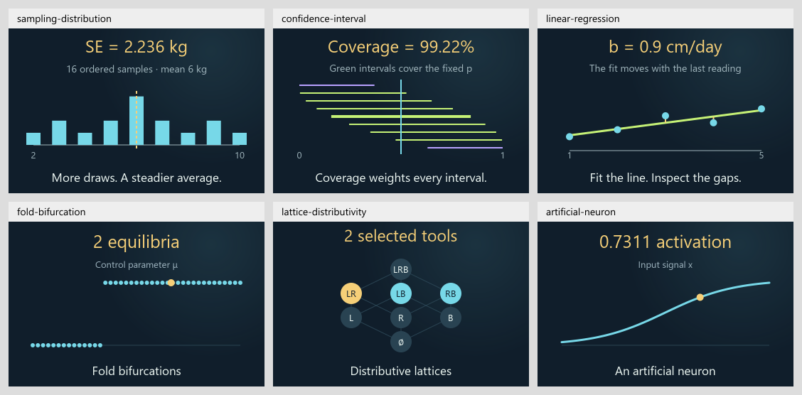

# Mathematical Expression Atlas

A visual field notebook for learning mathematics as a language of description.
Change an input, follow it through a story and formula, and see its effect in a
shape or graph. This branch prepares 0.34.0 with 84 draft lessons, adding
statistical inference, order structures, continuous dynamics, physical energy
and illustrative neural computation to the existing collection.

**[Open the live atlas](https://ppeck.me/mathcards/)** ·
[Project story](https://ppeck.me/projects/mathematical-expression-atlas/) ·
[Release history](CHANGELOG.md)

The live site remains on 0.33.0 while this expansion is reviewed on its separate
branch. A local branch build does not publish it.

The release version comes from [package.json](package.json). The generated
[build manifest](dist/build-manifest.json) records built card and example counts,
source hash and review status; [content/cards/](content/cards/) contains the
canonical lessons. Dated validation records describe the release they tested.



## Explore

- Browse the eight atlas territories or search the collection.
- Search the 18-subject book inventory and distinguish available introductions
  from preparation and planned lessons.
- Follow a real-life story into its calculation and visual. Geometry and Graph
  share the same inputs; selected lessons also have Spatial views.
- Look up unfamiliar words and symbols in the searchable reference, then open
  the cards that use them.
- Put modules side by side, compare saved readings and keep private notes.

Stories, models, views, reference entries and map placement are separate
modules. Shared controls, animation timing, paced numbers and saved-state
contracts let the collection grow without rebuilding its interface.

## Run it

Use the live link above, or open `START_HERE.html` after downloading the repository.
That single file includes the app and works offline without an account or API key.

For source development, use Node.js 22 and Python 3.11:

```sh
npm ci --ignore-scripts
python -m pip install -r requirements-checks.txt
python tools/build.py
npm run check:format
python tools/check_source.py
node --test --test-concurrency=2 tests/*.test.mjs
python tools/check.py
python -m http.server 4173 --directory src
```

Open `http://localhost:4173/`. The bounded test concurrency keeps the startup
budget measurement from competing with many simultaneous reference compilers.
To make a standalone ZIP, run `python tools/package.py`. Prettier is a pinned
development tool; the published app has no npm runtime dependency.
`npm run format` covers the declared incremental scope, excluding generated and
vendored files. `npm run measure:startup` runs three sequential background Node
measurements after a completed build; it does not launch a browser.

## Contribute a lesson

Edit canonical records in `content/` and add the model, connected story,
representations and reference entries through the shared playground contract.
Rebuild and commit generated files alongside source changes. CI rejects drift
in the offline app, index, formula projection and written exports before publishing.
Every validated push to `main` updates the hosted demo automatically.

| Guide | Purpose |
|---|---|
| [Architecture](docs/ARCHITECTURE.md) | Source layout and module boundaries |
| [Playground modules](docs/PLAYGROUND_MODULES.md) | Host, views and typed connections |
| [Reference index](docs/MATH_INDEX.md) | Definitions, symbols and actual card links |
| [Book roadmap](docs/BOOK_CONCEPT_ROADMAP.md) | Original 214 topic IDs, prerequisites and honest coverage |
| [Eight-book expansion](docs/EIGHT_BOOK_EXPANSION.md) | 295 supplied subjects, evidence boundaries and actual lesson links |
| [Branch matrix](docs/EXPANSION_MATRIX_0_34_0.md) | Completed expansion and remaining qualification |
| [Branch validation](docs/VALIDATION_0_34_0.md) | Checks, artifact integrity and explicit limits |
| [Build and deployment](docs/DEPLOYMENT.md) | Reproducible checks and publishing |
| [Published review](docs/REVIEW_RESPONSE_0_33_0.md) | 0.33.0 findings, repairs and qualification limits |
| [Published validation](docs/VALIDATION_0_33_0.md) | Recorded checks for the published baseline |

## Current limits

The lessons are drafts. Independent mathematical and learning review remains
open. Finite demonstrations do not establish general theorems, and constructed
stories are not empirical measurements. Written examples that require a different
function or data type stay distinct from executable presets.

The app stores personal notebooks and workspaces in browser storage; export a
backup before clearing it. Build tools never read those private records.

Detailed release notes belong in the [changelog](CHANGELOG.md); per-release
checks and visual evidence are linked from the corresponding review records.
