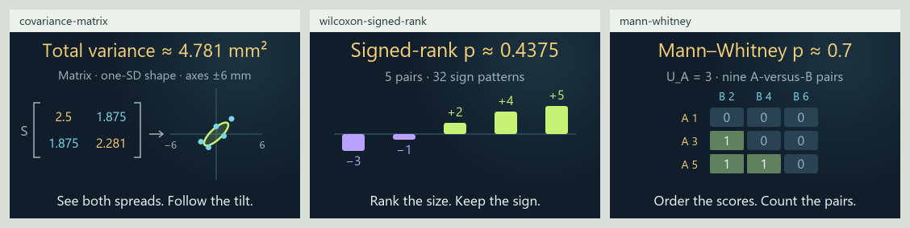

# 0.34.0 covariance matrix and rank-comparison matrix

Checkpoint record: the [130-card number/geometry matrix](NUMBER_GEOMETRY_EXPANSION_MATRIX_0_34_0.md)
identifies the current candidate. Counts and results below retain this earlier
checkpoint's evidence.

Current review candidate, 2026-11-03, on `codex/eight-book-expansion` in
[draft PR #13](https://github.com/ppeck1/mathcards/pull/13). This follows the
[123-card checkpoint](DESIGN_EXPANSION_MATRIX_0_34_0.md). Live remains 0.33.0.
Background repository checks and static images leave browser and phone
qualification open.

## Three connected lessons

| Lesson | Story → formula → visual | Boundary |
|---|---|---|
| [Covariance matrix](../content/cards/covariance-matrix.json) | Move five constructed laser-jig error pairs, follow their centered products into a two-by-two matrix, then see its eigenvalues set the ellipse radii | Both axes use millimetres and sample divisor four; the one standard deviation ellipse is descriptive, with no promised containment or confidence level; zero residual gives a line |
| [Wilcoxon signed rank](../content/cards/wilcoxon-signed-rank.json) | Compare five paired task times, omit zero changes, rank absolute changes and sum ranks by sign; enumerate all fair-sign patterns | Four or five nonzero constructed differences, midranks for ties, independent fair signs under a symmetric paired null and an inclusive two-sided tail; zero omission uses the Wilcoxon convention |
| [Mann–Whitney comparison](../content/cards/mann-whitney.json) | Compare three scores from each workflow, pool ranks, count wins plus half the ties and enumerate all 20 label allocations | Exchangeable labels under the equal-distribution null; positive common score scaling changes positions while leaving ranks and probability unchanged; no generic median or causal interpretation |

Each lesson has five original worked examples, executable presets, Geometry
and Graph, a matching preview, typed ports and reference entries linked to
actual lesson usage. One explicit comparison family joins the existing host.
Controls, animation, readable-value pacing, pins, private-state schemas and
existing model revisions keep their existing owners.

The rank-test graphs show evaluated probability levels and ordering events.
Their discrete changes are part of the mathematics. Continuous measurements
and shapes can move while ranks remain fixed; no smooth probability curve is
invented between ranking events. The exact reference enumerations include
ties. Numerical collapse produces a precision state rather than a false tie
or zero residual.

## Current corpus and atlas

| Measure | Current candidate | This continuation |
|---|---:|---:|
| Draft lessons | 126 | 3 |
| Original worked examples | 634 | 15 |
| Independent numeric fixtures | 2,215 | 215 |
| Written exports | 760 | 18 |
| Declared views | 259 | 6 |
| Reference entries | 1,133 | 54 |
| Selectable symbol forms | 910 | 20 |
| Notation meanings | 854 | 41 |

The branch adds 65 lessons to the published 61-card baseline. All 126 have
Geometry and Graph; seven also have Spatial. Twelve explicit metadata
families install 42 continuation modules through the same host. These are
implemented drafts, not counts of independently qualified lessons.

The eight territories and 24 neighborhoods remain stable. All three lessons
join Chance's statistics. Covariance matrices also connect to Structure's
linear algebra and Space's geometric measurement. Chance has 37 available
lessons, Structure 26 and Space 17. Memberships overlap. Topographic elevation
continues to encode available lesson count.

| Inventory | Stable topics | Bounded draft introductions | Preparation only | Planned |
|---|---:|---:|---:|---:|
| Eight-book inventory | 295 | 82 | 55 | 158 |
| Earlier four-book roadmap | 214 | 59 | 36 | 119 |

The nonparametric-statistics topic advances from preparation to a bounded
introduction through the sign test and these two rank procedures. Covariance
and matrix topics gain concrete links. General nonparametric theory, arbitrary
sample sizes, ANCOVA and matrix regression remain separate work. Imported
evidence, stable IDs and provisional book mappings remain unchanged. The
inventories overlap.

## What works and what is left

| Area | Current result | Remaining work |
|---|---|---|
| Connected lessons | Story quantities follow through three calculation stages into the changing measurements and scene marks | Observe learners and refine explanations after device review |
| Statistical comparison | Exact finite rank references, explicit ties/zeros and a descriptive covariance ellipse | Broader rank procedures, arbitrary samples, robust/nonnormal inference, estimator theory, unknown-spread power, ANCOVA and matrix regression |
| Atlas coverage | Three placements fill statistics and connect matrix structure to geometry | 158 planned book topics and 55 precursors, including number theory, geometry, proof, lattice representations and physical/neural models |
| Reference | All 87,102 audited occurrences resolve; data rank and matrix rank retain distinct meanings; covariance units distinguish mm, mm² and mm⁴ | Independent definition review and new terms as lessons expand |
| Visuals | Shared renderer proofs for previews and compact scenes; quantitative matrix, rank and pair-comparison marks | Browser layout, touch, zoomed text, non-default interactions and learner observation |
| Verification and startup | 1,231 JavaScript tests, 34 Python tests and 2,215 fixtures pass; three startup attempts span 413.4–432.2 ms under the unchanged 1500 ms gate | [Validation and artifact identity](VALIDATION_0_34_0_COMPARISON.md); delivery, first rendered view and real-device performance measurements |
| Independent review | Declared mathematical models and source boundaries | Exact-edition/page verification, expert mathematics/history review and teaching qualification |
| Release | Separate draft branch; live unchanged | Browser/phone, keyboard/focus, screen-reader MathML, reduced motion, actual offline/two-tab/file recovery and publication decision |

See the [current validation](VALIDATION_0_34_0_COMPARISON.md),
[full subject matrix](EIGHT_BOOK_SUBJECT_MATRIX.csv) and
[device walkthrough](RELEASE_CHECKS_0_34_0.md#review-that-still-needs-a-browser-or-phone).
Static source images and DOM harnesses do not complete those device rows.

[Compact scenes](presentation-0-34-comparison/compact-scenes.png) show actual
source layouts, rather than browser screenshots.
