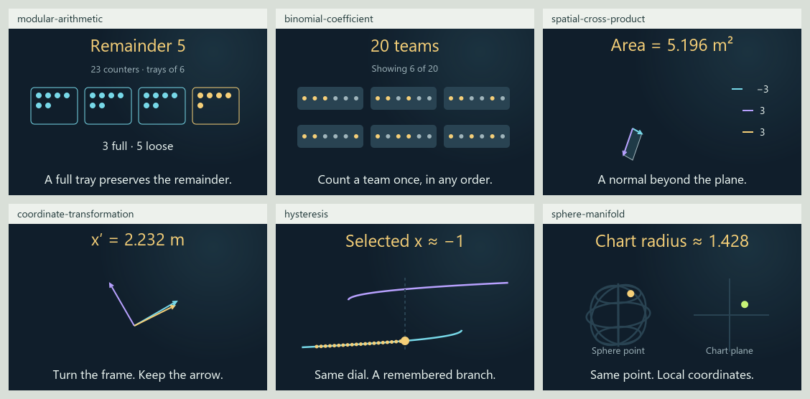

# 0.34.0 number/spatial continuation checkpoint

This matrix records the 102-card checkpoint. The
[atlas-gap matrix](GAP_EXPANSION_MATRIX_0_34_0.md) contains the current branch
counts, additional lessons and remaining work.

This is the current source matrix for `codex/eight-book-expansion`, continuing
[draft PR #13](https://github.com/ppeck1/mathcards/pull/13). It supersedes the
counts and next queue in the [initial 84-card checkpoint](EXPANSION_MATRIX_0_34_0.md).
The live site remains on 0.33.0; this branch has not been published.

The continuation adds 18 lessons and 90 originally authored examples. Models,
stories, reference terms, previews and integration metadata remain separate
modules sharing the existing playground space and lifecycle. No browser,
desktop app, tab or panel was opened or controlled during this work.

## Current corpus

| Measure | Current branch | Meaning |
|---|---:|---|
| Canonical lessons | 102 | All remain drafts with explicit review gaps |
| Worked examples | 514 | Authored examples, including 90 in this continuation |
| Numeric fixtures | 1,023 | Declared valid, invalid and boundary cases checked against independent references |
| Written exports | 616 | 102 concept records plus 514 example records; not 616 separate lessons |
| Declared views | 211 | 102 Geometry, 102 Graph and seven existing Spatial views |
| Atlas territories / neighborhoods | 8 / 24 | All 102 lessons have a map placement; every neighborhood has at least one executable draft |

Counts describe artifacts and stated coverage. They do not establish learning
quality, complete subjects or independent mathematical review. Final suite,
notation, startup and generated-artifact results belong in the
[continuation validation](VALIDATION_0_34_0_CONTINUATION.md).

## Eighteen new lessons

Each row has a canonical card, five original examples, connected story and
calculation stages, model-derived Geometry and Graph, a matching thumbnail,
searchable terms and symbols, explicit quantity bindings, typed ports and a
separate numerical reference. The name of a spatial topic does not create a
new Spatial view: these additions declare Geometry and Graph.

| Lesson | Connected calculation and visual | Boundary retained |
|---|---|---|
| [Modular arithmetic](../content/cards/modular-arithmetic.json) | Pack counters into full trays, then identify the remainder; graph exact whole totals | Nonnegative totals through 60, capacities 2–12; integer states never interpolate |
| [Greatest common divisor](../content/cards/greatest-common-divisor.json) | Follow the Euclidean remainder chain to the longest shared ribbon cut | Positive whole lengths through 60 cm; divisor enumeration checks the answer separately |
| [Prime factorization](../content/cards/prime-factorization.json) | Split a pack into prime factors and multiply them back to its item count | Integers 1–120; repetitions count, and 1 has no prime factors; no general unique-factorization proof |
| [Rational number](../content/cards/rational-number.json) | Rename a signed ribbon balance with a reduced fraction at the same number-line position | Bounded numerator and positive denominator; exact fraction reduction, not a general fraction-operation editor |
| [Numeral system](../content/cards/numeral-system.json) | Regroup one quantity into digits and show each place's contribution | Values 0–63 in bases 2–10; changing the numeral preserves the represented value |
| [Permutation count](../content/cards/permutation-count.json) | Assign distinct people to labeled roles and count successive choices | At most eight people; no repeated holder; zero roles has one empty assignment |
| [Binomial coefficient](../content/cards/binomial-coefficient.json) | Choose an unordered team; compare its count with ordered listings | At most ten people; displayed team prefixes are labeled; the full count is retained |
| [Spatial cross product](../content/cards/spatial-cross-product.json) | Change two edge vectors and follow their components into the normal and area | Square-metre normal components; projected drawing area is not the measured parallelogram area |
| [Scalar triple product](../content/cards/scalar-triple-product.json) | Change a slanted box's edges and compare signed triple product with absolute volume | A restricted triangular edge family; collapsed cases and orientation remain explicit |
| [Coordinate transformation](../content/cards/coordinate-transformation.json) | Turn an orthonormal frame and recompute the same arrow's coordinates | Passive coordinate change; the vector does not rotate and no general tensor law is claimed |
| [Vector projection](../content/cards/vector-projection.json) | Resolve a displacement into its parallel component and orthogonal residual | Nonzero reference vector required; signed scalar component differs from the projection vector |
| [Angular velocity](../content/cards/angular-velocity.json) | Follow constant angular rate into angular displacement and instantaneous rim velocity | Radians, explicit time and radius; speed and signed angular rate differ; no force or angular acceleration |
| [Linear momentum](../content/cards/linear-momentum.json) | Combine cart mass and velocity, with separate arrow scales for velocity and momentum | Newtonian momentum at one instant; angular momentum, collisions and stopping distance remain separate |
| [Hysteresis](../content/cards/hysteresis.json) | Follow a remembered stable branch as a dial moves forward and backward | Explicit quasi-static branch history; no switching-time simulation or biological memory claim |
| [Gradient flow](../content/cards/gradient-flow.json) | Follow the exact continuous trajectory down quadratic potential contours | A declared analytically solved family; elapsed time is not a discrete optimization step |
| [Circle manifold](../content/cards/circle-manifold.json) | Carry the same circle point between two stereographic coordinate charts | Unit-circle example with excluded chart poles; broader smooth-atlas theory remains preparation only |
| [Sphere manifold](../content/cards/sphere-manifold.json) | Connect a point on a sphere to coordinates on its chart plane | Unit-sphere example; a chart pole does not make the sphere singular, and no area/volume lesson is implied |
| [Structural stability](../content/cards/structural-stability.json) | Perturb two explicit velocity-rule families and compare equilibria and local types | Restricted hyperbolic/fold comparison; no certificate for arbitrary perturbations or general structural stability |

All seven number lessons use exact whole settings. Continuous geometry is used
only where the model admits continuous quantities. Story text, formula marks
and scene marks refer to the same evaluated quantities; unsupported domains
remain visible rather than being silently rounded or extrapolated.

## Atlas coverage

Territory counts below are unique within each territory. A lesson can appear
in several territories, so these rows must not be added to count lessons.

| Territory | Available draft lessons | New lessons placed here | Coverage gained |
|---|---:|---:|---|
| Foundations | 16 | 2 | Ordered assignments and unordered collections support counting and proof vocabulary |
| Numbers | 11 | 5 | Exact remainders, divisors, factors, signed fractions and positional notation |
| Algebra and structure | 20 | 5 | Spatial products, frame coordinates, projection and momentum components |
| Shape and space | 14 | 7 | Area/volume orientation, transformations and explicit local coordinate charts |
| Change and motion | 24 | 4 | Angular rate, continuous gradient flow, branch history and restricted perturbations |
| Chance and inference | 23 | 2 | Finite permutation and combination counts prepare probability calculations |
| Computation | 10 | 3 | Exact remainder, Euclidean and positional procedures |
| Applied mathematics | 18 | 2 | Constant angular motion and instantaneous linear momentum |

Every one of the 24 neighborhoods now has an executable draft, but this is
navigation coverage rather than subject completion. Complex numbers,
equations/optimization, graphs/networks and linear-time algorithms each still
have just one available lesson. Broader number systems, arbitrary vector
families, general manifolds and general perturbation theory remain gaps.

## Roadmap and source evidence

| Inventory | Stable IDs | Draft introduction | Precursor only | Planned |
|---|---:|---:|---:|---:|
| [Eight-book subjects](EIGHT_BOOK_EXPANSION.md) | 295 | 71 | 56 | 168 |
| [Earlier four-book roadmap](BOOK_CONCEPT_ROADMAP.md) | 214 | 59 | 36 | 119 |

These inventories overlap and retain their own IDs, book associations and
evidence states. Their totals must not be added as distinct mathematical
concepts. Eleven eight-book subjects gain direct bounded introductions through
the number/counting family; other additions strengthen existing preparation.
Circle/sphere charts and the restricted stability comparison retain precursor
status for the broad manifold and structural-stability topics. Linear momentum
does not complete a row that also requires angular momentum.

The supplied 295-subject JSON remains unchanged, with all 312 attributed
book/concept associations preserved. Provisional book mappings, absent page
locators and original-edition checks stay open. Primary references support the
stated definitions; they do not verify the attachment's exact book coverage or
turn original workshop stories into empirical observations.

## What is working and what remains

| Area | Current implementation/evidence | Remaining gate |
|---|---|---|
| Modular playground | Three trusted provider families plug into common instances, controls, views, quantities and ports | Human comparison of the new interactions in the shared workspace |
| Connected teaching | Every new story has explicit input, calculation and result stages tied to real model quantities | Learner comprehension, prediction and transfer review |
| Number validation | All 14 focused tests pass; exhaustive bounded checks and independent Python references cover the seven number families | Independent mathematical and pedagogical review |
| Static previews | All 18 default previews were rendered sequentially with explicit math-font fallback; glyph checks found no text overlap, overflow, font below 13 px or art label beyond y=188 | Browser fonts, actual card layout, zoom and phone readability are not qualified by static SVGs |
| Searchable reference | 802 entries; all 72,192 audited occurrences resolve; 789 selectable forms cover 595 meanings | Visual browsing, keyboard and screen-reader review of the complete catalog |
| Atlas and subjects | Actual lesson placements and honest introduction/precursor/planned states remain distinct | Touch overview, zoom, labels and navigation on real devices |
| Generated release | Full build, 1,083 JavaScript tests, 28 Python tests and 1,023 numeric fixtures pass; sequential startup median 359.4 ms against the unchanged 1500 ms budget | Background evidence qualifies code and artifacts; real browser delivery and device behavior remain open |
| Saved state and offline use | Existing adapter and revision contracts remain shared by the additions | Fresh-browser export/import, offline, download and recovery walkthroughs |
| Publishing | Work remains in the existing draft PR; live 0.33.0 is unchanged | Review and explicit release decision after qualification |

The [qualification checklist](QUALIFICATION_0_34_0.md) keeps browser, mobile,
keyboard, screen-reader, reduced-motion, enlarged-text and offline/recovery
checks open. Automated numerical checks and static images do not close those
gates. No physical-device performance or accessibility certification is claimed.

[All 18 static preview proofs](presentation-0-34-continuation/previews.png) show
the actual central preview SVG outputs at their default parameters. They
document those static geometries, not the surrounding browser interface.
