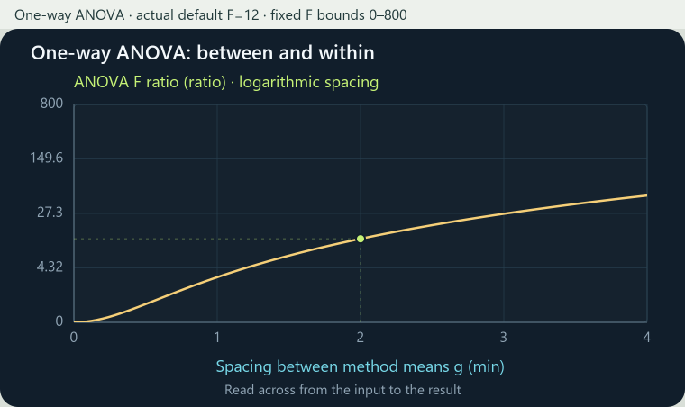
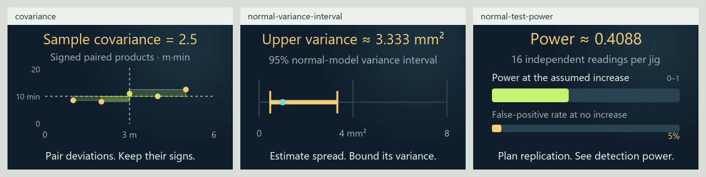

# 0.34.0 covariance, spread and planning matrix

Current review candidate, 2026-11-03, on `codex/eight-book-expansion` in
[draft PR #13](https://github.com/ppeck1/mathcards/pull/13). This follows the
[120-card checkpoint](SAMPLING_EXPANSION_MATRIX_0_34_0.md). Live remains
0.33.0. Background repository work and static source rendering do not complete
browser, desktop or phone qualification.

## Three connected lessons

| Lesson | Story → calculation → visual | Boundary |
|---|---|---|
| [Sample covariance](../content/cards/covariance.json) | Pair board lengths with finishing times, center both measurements, multiply signed deviations and divide their total by four | Five constructed pairs, sample divisor n−1 and metre-minute units; the declared residual pattern preserves covariance while changing the point cloud; no causal or population inference |
| [Normal-variance interval](../content/cards/normal-variance-interval.json) | Square observed sample spread, multiply by n−1 and divide by two chi-square quantiles to place asymmetric variance endpoints | Independent identically normal readings with unknown mean/variance; fixed 95% procedure; displayed whole n 6–31; unknown population variance has no supplied location |
| [Replication and test power](../content/cards/normal-test-power.json) | Enter independent readings per group, an assumed true difference and known common spread; follow standard error and a predeclared cutoff into rejection probability | Equal normal groups, known sigma and a one-sided 5% rule; n is per group and 2n is total; the effect is a planning assumption, not observed evidence or a causal result |

Each lesson has five original worked examples, executable presets,
Geometry/Graph, a matching preview, scoped reference entries and typed ports.
One explicit local family joins the same host. Controls, pacing, clocks,
pins, saved-state schemas and existing model revisions stay with their
existing owners. Quantiles are numerical constants prepared offline; the
power model reuses the existing normal-tail helper.

## ANOVA graph refinement

The shared plot renderer accepts an optional nonnegative vertical
`log1p` scale. ANOVA alone opts in: the original 0–800 F bounds remain fixed,
vertical positions use logarithmic spacing after adding one, and tick labels,
current readings and pins retain original F values. Horizontal dragging is
unchanged. Equal F values keep equal heights across parameter families.

This resolves the preceding checkpoint's visually flat default graph without
silently rescaling to each result. The logarithmic-axis reader explains the
spacing in the index. Default linear plots retain their projection, and
unsupported or numerically collapsed scale ranges produce a finite fallback.

## Current corpus and roadmap

| Measure | Current candidate | This continuation |
|---|---:|---:|
| Draft lessons | 123 | 3 |
| Original worked examples | 619 | 15 |
| Independent numeric fixtures | 2,000 | 220 |
| Written exports | 742 | 18 |
| Declared views | 253 | 6 |
| Reference entries | 1,079 | 46 |
| Selectable symbol forms | 890 | 10 |
| Notation meanings | 813 | 36 |

The branch adds 62 lessons to the published 61-card baseline. All 123 have
Geometry and Graph; seven also have Spatial views. These counts describe
implemented drafts rather than independent teaching qualification.

The eight territories and 24 neighborhoods remain stable. Covariance joins
Structure's linear algebra and Space's geometric measurement as well as
Chance's statistics: centered numerical products connect the same lesson
across the map. Structure has 25 available lessons, Space 16 and Chance 34.
Other territory counts remain at their previous values; memberships overlap.
Topographic elevation continues to encode available lesson count.

| Inventory | Stable topics | Draft introductions | Preparation only | Planned |
|---|---:|---:|---:|---:|
| Eight-book inventory | 295 | 81 | 56 | 158 |
| Earlier four-book roadmap | 214 | 59 | 36 | 119 |

Covariance and variance inference gain bounded introductions. Replication
remains preparation, strengthened by the explicit known-spread power plan;
general experimental design is separate. Analysis of covariance, general
estimation and broader normal-sampling theory are not upgraded by these
models. Imported evidence, stable topic IDs and provisional book mappings
remain unchanged. The inventories overlap.

## What is left

| Area | Current result | Remaining work |
|---|---|---|
| Statistical concepts | Covariance, a normal-variance interval and known-spread two-group power | Covariance matrices/ANCOVA, rank methods, general estimator theory, robust/nonnormal inference, unknown-spread power and broader replication/design |
| Atlas coverage | Explicit connected placements and learner order | 158 planned book topics and 56 precursors, including geometry, numbers, proof, lattice representations, physical and neural models |
| Reference | All 84,583 audited occurrences resolve; new definitions have actual lesson links and units retain their own meanings | Independent definition review and future terms as lessons expand |
| Visuals | Actual shared preview/scene boards; improved fixed-scale ANOVA graph | Browser layout, touch, enlarged text, non-default interactions and learner observation |
| Verification and startup | 1,220 JavaScript tests, 34 Python tests and all 2,000 fixtures pass; three startup attempts span 392.5–515.5 ms under the unchanged 1500 ms gate | [Validation and artifact identity](VALIDATION_0_34_0_DESIGN.md); delivery/full first render require device measurement |
| Independent review | Primary definitions and exact scope are recorded | Exact-edition/page checks, expert mathematical/history review and teaching qualification |
| Release | Separate draft branch | Browser/phone, keyboard/focus, screen-reader MathML, reduced motion, actual offline/two-tab/file recovery and publication decision; live remains unchanged |

The [full subject matrix](EIGHT_BOOK_SUBJECT_MATRIX.csv) and
[device walkthrough](RELEASE_CHECKS_0_34_0.md#review-that-still-needs-a-browser-or-phone)
retain the detailed remaining work. Node tests, XML parsing and static source
images do not complete the device rows.

[Compact scenes](presentation-0-34-design/compact-scenes.png) show the actual
compact source layouts, rather than browser screenshots.
