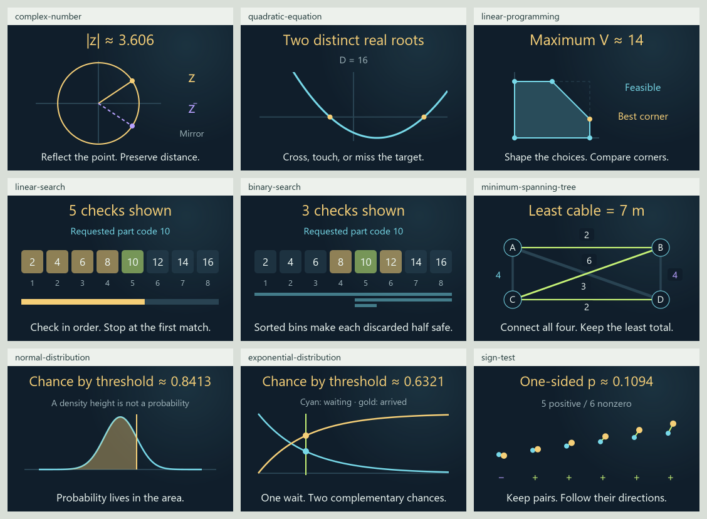

# 0.34.0 atlas-gap expansion matrix

Historical 111-card checkpoint. The
[117-card roadmap continuation](ROADMAP_EXPANSION_MATRIX_0_34_0.md) supersedes
its current corpus counts. The browser/phone review rows below remain pending
and also apply to the additional lessons.

Current review candidate on `codex/eight-book-expansion`, continuing
[draft PR #13](https://github.com/ppeck1/mathcards/pull/13). This supersedes the
current-state counts in the [102-card checkpoint](CONTINUATION_MATRIX_0_34_0.md).
The live site remains 0.33.0. Work used background repository processes and
static rendering; no browser, app, tab or desktop panel was controlled.

## Current corpus

| Measure | Branch total | This continuation |
|---|---:|---:|
| Draft lessons | 111 | 9 |
| Original worked examples | 559 | 45 |
| Independent numeric fixtures | 1,256 | 233 |
| Written exports | 670 | 54 |
| Declared views | 229 | 18 |

All 111 lessons have Geometry and Graph; seven older lessons also have Spatial.
The 0.34.0 branch now adds 50 lessons to the published 61-card baseline.
Counts record material and implementation, not teaching qualification.

## Nine connected lessons

Every row has a pure provider, story, three calculation stages, Geometry/Graph,
matching preview, authored reference entries, exact quantity bindings and typed
ports. Families share the existing controls, animation, readable numbers,
comparisons and saved-state lifecycle. Each card has five original examples.

| Lesson | Story → calculation → visual | Scope and boundary |
|---|---|---|
| [Complex numbers](../content/cards/complex-number.json) | A plotter offset becomes real/imaginary components, a conjugate reflection and a radius | Modulus and conjugation in a unitless frame; multiplication remains its separate linked lesson |
| [Quadratic equations](../content/cards/quadratic-equation.json) | Lift a calibration curve; follow discriminant sign into crossings or tangency | Positive leading coefficient, real roots only; exact represented-input sign with numerical root coordinates |
| [Linear programming](../content/cards/linear-programming.json) | Paint-blend choices form a feasible polygon; compare contribution at its corners | Continuous litres, bounded constraints, exact objective comparisons; whole optimal edges and flat objectives remain visible |
| [Linear search](../content/cards/linear-search.json) | A clerk requests a part; reveal successive bin comparisons | Fixed eight-bin list; performed comparisons and full-run cost are distinct; absence checks every bin |
| [Binary search](../content/cards/binary-search.json) | Use the same sorted bins and discard impossible halves | Whole comparisons, stated sorted input and excluded sorting cost; empty windows certify absence in this list |
| [Minimum spanning tree](../content/cards/minimum-spanning-tree.json) | Connect four sensor stations using the least total quoted cable | A connected fixed graph, exact whole-metre costs and all tied minima; station layout is schematic |
| [Normal distribution](../content/cards/normal-distribution.json) | A cutting-error threshold becomes a standardized value and cumulative area | Density height differs from probability; fixed drawing window does not renormalize tails or establish normality |
| [Exponential waiting time](../content/cards/exponential-distribution.json) | Follow a constant arrival rate into the chance of arrival and remaining wait | Continuous waiting time, cumulative/survival complement and explicit units; actual service data assumptions remain unvalidated |
| [Paired sign test](../content/cards/sign-test.json) | Follow paired ruler changes into signs, fair-sign patterns and a one-sided tail | Independent pairs, a declared null model, omitted exact ties and no evidence when all pairs tie; not the entire nonparametric field |

## Atlas gaps reduced

The eight territories and 24 neighborhoods remain stable. All neighborhoods
already had a draft; this batch deepens the sparsest ones. These counts are
unique within each neighborhood and must not be added as distinct lessons.

| Neighborhood | Before | Now | Addition |
|---|---:|---:|---|
| Complex numbers | 1 | 2 | Components, modulus and conjugation before multiplication |
| Equations and optimization | 1 | 3 | Quadratic roots and feasible linear choices |
| Graphs and networks | 1 | 2 | Spanning networks contrasted with shortest routes |
| Linear-time algorithms | 1 | 2 | An actual sequential search trace |
| Statistics | 9 | 10 | Paired signs as one bounded nonparametric preparation |
| Probability | 14 | 16 | Two continuous laws beside discrete probability masses |

Territory availability is now Foundations 16, Numbers 12, Structure 23, Space
15, Change 24, Chance 26, Computation 13 and Applications 19. Membership
overlaps; topographic elevation continues to represent available lesson count.
Binary search stays in Algorithms rather than being labeled linear-time.

## Verification and remaining work

| Area | Current evidence | Still needed |
|---|---|---|
| Modular integration | Independent slots, source order, actual bindings, typed ports and story primary-variable checks | Human comparison of the interactions in the workspace |
| Saved work | All 111 notebook defaults and 229 workspace views round-trip with exact recorded data; stale notebook writes preserve external bytes and keep pending work exportable | Actual two-tab behavior, reload, file pickers/downloads, mobile storage and disconnected restore |
| Mathematics | Independent finite oracles, exact branch/tie checks, quantified Gaussian grid error and explicit precision failures | Independent expert and learner review at the stated depth |
| Reference | 897 entries, 834 selectable forms and 677 meanings; all 76,271 audited occurrences resolve; retained new readers have actual card links | Real keyboard, visual browsing and screen-reader review |
| Visuals | Nine new previews have static glyph bounds evidence; all 111 previews and 916 default desktop/compact view fragments pass strict SVG/ID/reference and two-slot namespace checks | Actual page layout, touch, enlarged text, font behavior and non-default visual states |
| Build and performance | 39 focused JavaScript tests and 34 Python pipeline tests pass; full PR CI runs 1,165 JavaScript tests; all 1,256 numeric fixtures remain valid. The latest three startup attempts span 360.2–392.9 ms under the unchanged 1,500 ms gate | Browser delivery, full first render and physical-device qualification remain open; [current release evidence](RELEASE_CHECKS_0_34_0.md) and [paired performance checkpoint](STARTUP_OPTIMIZATION_0_34_0.md) retain their exact scopes and slower samples |
| Release | Existing draft PR contains the candidate | Review and a release decision; live remains unchanged |

The [current release-check record](RELEASE_CHECKS_0_34_0.md) records the notebook
repair, reproducible scene preflight, artifact/package checks and exact
qualification limits. The scene audit now runs in CI; its failure-detection
fixtures join the Python pipeline. The mathematical corpus remains unchanged.

## Browser and phone review still pending

These are observations to collect on the candidate artifact, not checks
completed by the background suite. The [review route and device plan](RELEASE_CHECKS_0_34_0.md#review-that-still-needs-a-browser-or-phone)
gives a concrete sequence; the broader [qualification checklist](QUALIFICATION_0_34_0.md)
also retains independent mathematical/history and learner review.

| Review | Desktop/browser | Phone | Evidence still needed |
|---|---|---|---|
| Full startup | Pending | Pending | First useful content/input including delivery, storage and main rendering, on fresh and warm loads |
| Story → formula → shape | Pending | Pending | Readable numbers and continuous drag response across Geometry/Graph/Spatial; invalid and boundary states |
| Atlas, index and search | Pending | Pending | Overview fits eight territories; all symbols remain selectable; filters, paging and Back/Forward preserve context |
| Layout and text | Pending | Pending | Long formulas, zoom/enlarged text, clipping, contrast, orientation and narrow-width labels |
| Keyboard and assistive technology | Pending | Pending | Focus order/traps, screen-reader MathML/SVG/control names and operable touch/keyboard alternatives |
| Motion and gestures | Pending | Pending | Pause/reset, live reduced-motion changes, fractal zoom and map/scene dragging without blocking page scrolling |
| Save/restore and offline use | Pending | Pending | Real two-tab warnings, downloads/imports, storage restrictions and disconnected standalone recovery using disposable data |

## Remaining concept coverage

| Inventory | Stable topics | Draft introductions | Preparation only | Planned |
|---|---:|---:|---:|---:|
| Eight-book subject inventory | 295 | 74 | 56 | 165 |
| Earlier four-book roadmap | 214 | 59 | 36 | 119 |

These overlapping inventories retain separate IDs and evidence states. Normal
sampling, general optimization, broad nonparametric methods and complexity
remain preparation. Other prominent content gaps include inverse functions,
general number systems, graph coloring, broader experimental design and
statistical estimation. Arbitrary proof editing, general manifolds and general
perturbation theory also remain separate work.

The [qualification checklist](QUALIFICATION_0_34_0.md) remains open for mobile,
keyboard, assistive technology, offline recovery and teaching observation.
Automated controllers and static drawings do not close those gates.

[Compact scene board](presentation-0-34-gaps/compact-scenes.png) shows actual
360-wide source layouts. It is a static geometry proof, not a phone screenshot.
