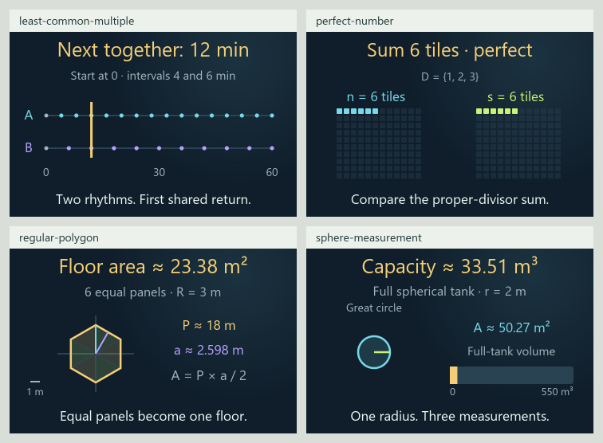

# 0.34.0 number theory and geometry expansion matrix

The [142-card insight matrix](INSIGHT_EXPANSION_MATRIX_0_34_0.md) and
[current validation](VALIDATION_0_34_0_INSIGHTS.md) supersede this dated checkpoint.
Its recorded counts and timing samples are retained below.

Current review candidate, 2026-11-05, on `codex/eight-book-expansion` in
[draft PR #13](https://github.com/ppeck1/mathcards/pull/13). This follows the
[126-card comparison checkpoint](COMPARISON_EXPANSION_MATRIX_0_34_0.md).
Live remains 0.33.0. Background checks and static source images leave browser
and phone qualification open.

## Four connected lessons

| Lesson | Story → calculation → visual | Boundary |
|---|---|---|
| [Least common multiple](../content/cards/least-common-multiple.json) | Two workshop signals repeat at different minute intervals; follow their greatest common divisor into ab/d and the first shared return | Whole periods 1–8 minutes; zero is the shared start, L is the first positive reunion; a fixed 0–60 minute timeline and integer graph preserve the actual times |
| [Perfect numbers](../content/cards/perfect-number.json) | A workshop exhibit makes one tile strip for every proper divisor; compare their combined count with the original number | Exact integers 1–60, with the number itself excluded; one has an empty divisor set and sum zero; classify the shown integer rather than claim a theorem about all perfect numbers |
| [Regular polygon](../content/cards/regular-polygon.json) | Split a pavilion floor into equal triangular panels; follow radius and side count into side length, apothem, perimeter and floor area | Convex regular polygons with 3–12 whole sides and circumradius 1–4 m; radius and apothem differ; arbitrary/star polygons and classical constructibility remain separate |
| [Sphere measurement](../content/cards/sphere-measurement.json) | Change a full ideal spherical tank's radius; follow diameter, surface area and enclosed volume into the illustration and a fixed volume bar | Radius 0.25–5 m; the sphere's surface, enclosed ball and central disk have different measures; a projected circle does not encode volume |

Each lesson has five original examples, executable presets, Geometry and
Graph, a matching preview, typed ports and searchable readers with actual
lesson links. Two explicit families install through the same host. Existing
controls, clocks, readable-value pacing, pins, private-state schemas and model
revisions retain their owners.

The number graphs use separate integer samples. Whole side counts also remain
discrete. Radius changes can flow continuously; polygon area grows with its
square and tank volume with its cube. Fixed scales preserve these changes.
Rounded derived readings use approximation signs rather than false equalities.

## Current corpus and atlas

| Measure | Current candidate | This continuation |
|---|---:|---:|
| Draft lessons | 130 | 4 |
| Original worked examples | 654 | 20 |
| Independent numeric fixtures | 2,471 | 256 |
| Written exports | 784 | 24 |
| Declared views | 267 | 8 |
| Reference entries | 1,166 | 33 |
| Selectable symbol forms | 923 | 13 |
| Notation meanings | 877 | 23 |

The branch adds 69 lessons to the published 61-card baseline. All 130 have
Geometry and Graph; seven also have Spatial. Fourteen explicit metadata
families install 46 continuation lessons through the shared host. These counts
describe implemented drafts rather than independent teaching qualification.

The eight territories and 24 neighborhoods remain stable. Numbers now has
15 available lessons and Space 19. The highest summit remains Chance's 37;
the declared contour interval remains five lessons. Counts overlap across
territories. Elevation still means available lesson count.

| Inventory | Stable topics | Bounded draft introductions | Preparation only | Planned |
|---|---:|---:|---:|---:|
| Eight-book inventory | 295 | 85 | 55 | 155 |
| Earlier four-book roadmap | 214 | 59 | 36 | 119 |

Perfect numbers, regular polygons and sphere measurement advance from planned
to bounded introductions. LCM supplies an additional bridge to divisibility
and repeating schedules. General Euclidean geometry retains preparation
status. Stable IDs, supplied book evidence and provisional mappings stay
intact; the overlapping inventories are not added together.

## What works and what is left

| Area | Current result | Remaining work |
|---|---|---|
| Number theory | Exact LCM, proper divisors, empty-sum case and deficient/perfect/abundant comparisons connect to gcd and prime factors | Irrational numbers, broader divisibility, deeper prime theory and additional finite number-theory families |
| Geometry | Equal-panel regular polygons and separate spherical length/area/volume measures | Similarity, broader triangle/circle measurement, solids, golden ratio, constructions, tessellations and non-Euclidean geometry |
| Stories and visuals | Variables follow through real scenarios and calculations into measured shapes; previews use actual model outputs | Learner observation and device-specific refinement |
| Reference | All 89,051 audited occurrences resolve; local signal names, periods, divisors, polygon measurements, spherical measures and physical units have linked readers | Independent definition review and new notation as lessons expand |
| Atlas roadmap | Three planned topics gain bounded introductions; Numbers and Space gain four lessons | 155 planned topics and 55 precursors, including proof, lattice representations and broader physical/neural models |
| Verification and startup | 60 focused JavaScript checks, 34 Python tests and 2,471 fixtures pass; three startup attempts span 889.0–1148.8 ms under the unchanged 1500 ms gate | [Current validation](VALIDATION_0_34_0_NUMBER_GEOMETRY.md) and full PR workflow; browser delivery, first rendered view and real-device performance |
| Independent review | Definitions and mathematical model boundaries are cited | Expert mathematics/history review, exact-edition/page verification and teaching qualification |
| Release | Separate draft branch; live unchanged | Browser/phone layout and interactions, keyboard/focus, screen-reader MathML, reduced motion and real offline/file/two-tab recovery |

See the [current validation](VALIDATION_0_34_0_NUMBER_GEOMETRY.md),
[full subject matrix](EIGHT_BOOK_SUBJECT_MATRIX.csv) and
[device walkthrough](RELEASE_CHECKS_0_34_0.md#review-that-still-needs-a-browser-or-phone).
DOM harnesses and static images do not complete device review.

[Compact scenes](presentation-0-34-number-geometry/compact-scenes.png) show
actual source layouts rather than browser screenshots.
