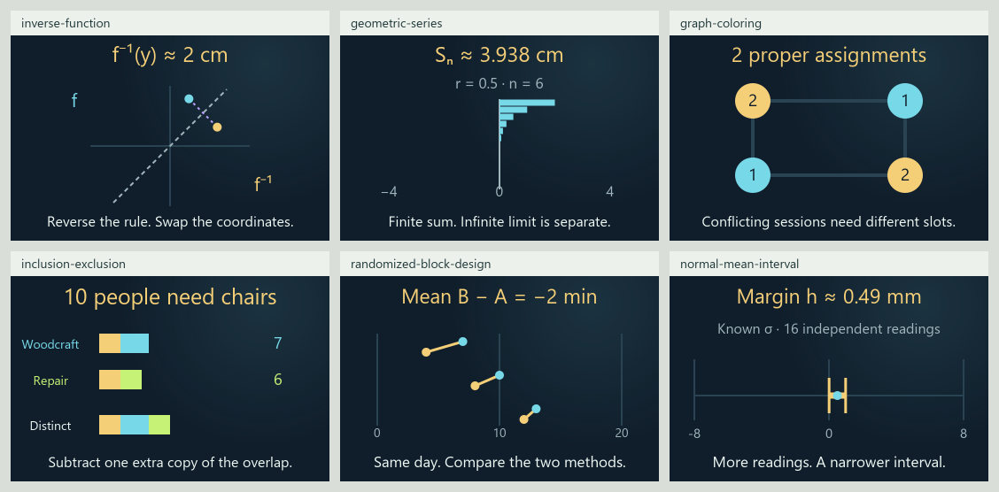

# 0.34.0 roadmap-gap expansion matrix

This records the 117-card checkpoint. The [current inference continuation](SAMPLING_EXPANSION_MATRIX_0_34_0.md)
adds Student intervals, exhaustive randomization and one-way ANOVA.

Current review candidate, updated 2026-11-03 on `codex/eight-book-expansion` in
[draft PR #13](https://github.com/ppeck1/mathcards/pull/13). This supersedes the
current corpus counts in the [111-card checkpoint](GAP_EXPANSION_MATRIX_0_34_0.md).
The live site remains 0.33.0. Work used background repository processes and
static source rendering, without browser, desktop or phone interaction.

## Six connected lessons

| Lesson | Story → calculation → visual | Boundary |
|---|---|---|
| [Inverse functions](../content/cards/inverse-function.json) | Recover a positioning-stage command by subtracting its calibration offset and dividing by gain; exchange the forward/inverse points across an equal-scale diagonal | One nonzero affine family; negative gain reverses orientation, and interpolation cannot cross zero gain |
| [Geometric series](../content/cards/geometric-series.json) | Add successive signed positioning corrections; follow each term into the net distance and whole-command partial sums | Finite sums remain valid at ratio 1; the infinite limit is shown only for absolute ratio below 1; general series tests remain separate |
| [Graph coloring](../content/cards/graph-coloring.json) | Put four conflicting sessions into labeled time slots; count proper assignments and identify the smallest usable palette | A four-cycle with an optional diagonal, certified by finite enumeration; no general graph editor or scheduling optimizer |
| [Inclusion–exclusion](../content/cards/inclusion-exclusion.json) | Merge two workshop signup lists; remove the extra copy of shared attendees and provide one chair per distinct person | Two explicit finite sets with exact consistent counts; this is a count rather than a probability model |
| [Randomized blocks](../content/cards/randomized-block-design.json) | Compare packing methods within each day, then average the three differences as shared day offsets cancel | Constructed complete blocks and two displayed allocations; random assignment is part of the stated plan, not generated; no ANOVA, p-value or empirical causal claim |
| [Normal-mean interval](../content/cards/normal-mean-interval.json) | Follow a known population spread and whole sample size into standard error, margin and two interval endpoints around the observed mean | Independent normal readings with known positive sigma and fixed 95% procedure; no posterior probability, prediction interval or unknown-sigma method |

Each card has five distinct original examples, a connected story, three
calculation stages, Geometry/Graph, matching preview, scoped reference entries
and typed ports. Three local families install through the existing contract;
the host still owns controls, animation, readable numbers, pins and private
state. No additional loader, framework or animation clock was introduced.

## Current corpus

| Measure | Candidate total | This batch |
|---|---:|---:|
| Draft lessons | 117 | 6 |
| Original worked examples | 589 | 30 |
| Independent numeric fixtures | 1,565 | 309 |
| Written exports | 706 | 36 |
| Declared views | 241 | 12 |
| Reference entries | 981 | 84 |
| Selectable symbol forms | 865 | 31 |
| Indexed notation meanings | 739 | 62 |

All 117 lessons have Geometry and Graph; seven retain additional Spatial views.
The complete review branch now adds 56 lessons to the published 61-card
baseline. Counts describe implemented drafts and recorded material, rather
than independent teaching qualification.

## Atlas and book-roadmap progress

The eight territories and 24 neighborhoods remain stable. Availability is
Foundations 18, Numbers 13, Structure 24, Space 15, Change 25, Chance 28,
Computation 14 and Applications 20. Memberships overlap and must not be added
as distinct lessons. Topographic elevation continues to encode available
lesson count. Learner order places the new cards beside their prerequisites.

| Inventory | Stable topics | Draft introductions | Preparation only | Planned |
|---|---:|---:|---:|---:|
| Eight-book subject inventory | 295 | 77 | 57 | 161 |
| Earlier four-book roadmap | 214 | 59 | 36 | 119 |

Blocking, series and graph coloring move from planned to bounded introductions.
Randomization gains a precursor link while allocation generation and its
sampling distribution remain planned. Existing function, set/counting and
confidence-interval rows gain more specific lessons. Normal sampling and
general estimator theory retain precursor status. Raw book evidence and all
stable topic IDs remain unchanged; the two inventories overlap.

## What is left

| Area | Current evidence | Remaining work |
|---|---|---|
| Implementation | Shared-host integration, independent slots, actual quantity bindings, numeric fixtures, source order and complete backup/view coverage | Additional lessons follow the same contract; no host rewrite is required |
| Definitions and notation | 981 entries; all 79,626 audited occurrences resolve across 49,182 fields and 1,497 tokens, with zero unresolved/review items | Expand the finite reference as new notation is introduced; real visual/keyboard/screen-reader review remains open |
| Visuals | Six previews and compact scenes rendered from actual source; glyph-bounds and strict SVG/reference/slot checks | Actual page layout, touch, enlarged text, fonts and non-default visual behavior |
| Build and startup | 1,196 JavaScript tests, 34 Python tests and all 1,565 fixtures pass; three startup attempts span 515.4–784 ms under the unchanged 1500 ms gate | Full results and artifact identity are in the [validation record](VALIDATION_0_34_0_ROADMAP.md); browser delivery and full first render remain unmeasured |
| Statistics and design | Known-sigma normal intervals and descriptive blocks join finite inference and regression | Unknown-sigma Student intervals, broader estimation, replication, randomization distributions, ANOVA and general design/error models |
| Foundational and discrete mathematics | Affine inverse, one geometric family, two-set counts and a four-vertex coloring certificate | General number systems, broader inverse domains, convergence tests, arbitrary graph algorithms and proof techniques |
| Geometry, order and physics | Existing bounded vector/chart, lattice, dynamics, energy and learning models remain | Geometric constructions, broader manifolds, lattice ideals/representations, physical/statistical mechanics and larger neural/computational models |
| Independent review | Primary definitions are linked and mathematical scope is explicit | Exact-edition/page verification, independent expert/history review and learner observations |
| Release | Existing draft PR and explicit release gates | Browser/phone qualification and a separate publication decision; live remains unchanged |

The full [subject matrix](EIGHT_BOOK_SUBJECT_MATRIX.csv) lists every remaining
planned or precursor row. The [browser and phone review matrix](GAP_EXPANSION_MATRIX_0_34_0.md#browser-and-phone-review-still-pending)
and [release walkthrough](RELEASE_CHECKS_0_34_0.md#review-that-still-needs-a-browser-or-phone)
also apply to these six lessons. None of those device checks is marked complete
by a Node process, XML parser or static image.

[Compact scene board](presentation-0-34-roadmap/compact-scenes.png) shows the
actual 360-wide source layouts, using explicit local fonts. These are static
source proofs, rather than browser or phone screenshots.
