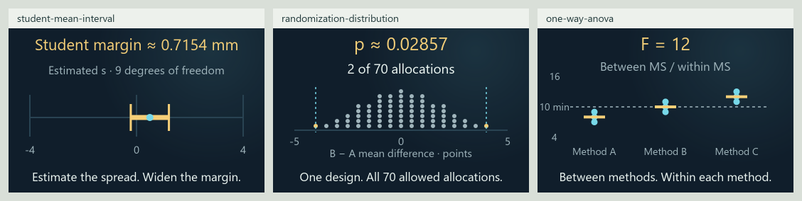

# 0.34.0 inference continuation matrix

This records the 120-card checkpoint. The [current 123-card matrix](DESIGN_EXPANSION_MATRIX_0_34_0.md)
adds covariance, variance inference and power, and resolves the flat ANOVA graph.

Current review candidate, 2026-11-03, on `codex/eight-book-expansion` in
[draft PR #13](https://github.com/ppeck1/mathcards/pull/13). This follows the
[117-card roadmap checkpoint](ROADMAP_EXPANSION_MATRIX_0_34_0.md). The live
site remains 0.33.0. Work uses background repository processes and static
source rendering; browser, desktop and phone qualification remains open.

## Three connected lessons

| Lesson | Story → calculation → visual | Scope |
|---|---|---|
| [Student mean interval](../content/cards/student-mean-interval.json) | Follow estimated calibration spread through standard error and the Student multiplier into two interval endpoints | Independent identically normal readings; unknown population spread; whole sample sizes 2–31; fixed 95% procedure; a mean interval, not a prediction or posterior probability |
| [Randomization distribution](../content/cards/randomization-distribution.json) | Change one learner's score, compare every balanced allocation's mean difference, and count the highlighted tail | All 70 four-versus-four assignments under a uniform design and a sharp no-effect null; inclusive absolute tails; exact score-threshold comparisons, no Monte Carlo draws |
| [One-way ANOVA](../content/cards/one-way-anova.json) | Move three method means apart or widen their observations; follow sums of squares through degrees of freedom into mean squares and F | Three groups of three constructed times; F(2,6) reference requires independent normal errors with common variance; no causal or pairwise conclusion |

Each lesson has five original worked examples, executable presets, Geometry
and Graph, a matching preview, scoped definitions/symbols and typed ports.
One explicit local family joins the existing model/story/preview/reference
providers. The host continues to own controls, paced numbers, timing, pins and
private state; no framework, sampler, loader or second animation clock is added.

## Progress

| Measure | Current candidate | This continuation |
|---|---:|---:|
| Draft lessons | 120 | 3 |
| Original worked examples | 604 | 15 |
| Independently checked numeric fixtures | 1,780 | 215 |
| Written exports | 724 | 18 |
| Declared views | 247 | 6 |
| Reference entries | 1,033 | 52 |
| Selectable symbol forms | 880 | 15 |
| Indexed notation meanings | 777 | 38 |

The complete branch adds 59 lessons to the published 61-card baseline. All
120 lessons have Geometry and Graph; seven also have Spatial views. These
are implemented draft lessons, with independent teaching review still open.

The eight territories and 24 neighborhoods remain stable. Chance gains three
lessons, reaching 31; topographic elevation still encodes available lesson
count. Learner order places Student after the known-spread interval,
randomization after hypothesis testing, and ANOVA beside design/comparison.

| Inventory | Stable topics | Draft introductions | Preparation only | Planned |
|---|---:|---:|---:|---:|
| Eight-book subject inventory | 295 | 79 | 56 | 160 |
| Earlier four-book roadmap | 214 | 59 | 36 | 119 |

Randomization and ANOVA advance from preparation to bounded introductions.
Replication gains preparation through the three observations per group.
Confidence intervals and hypothesis tests gain additional distinct procedures.
Normal sampling and general estimation retain precursor status. The imported
book evidence, stable topic IDs and provisional mappings remain unchanged;
the two inventories overlap and cannot be added as unique subjects.

## What is left

| Area | Implemented here | Remaining work |
|---|---|---|
| Statistics | Known/estimated-spread mean intervals, exact balanced randomization, one-way sums of squares and F | Broader estimation and variance inference; power and replication design; general ANOVA, interactions with error models, covariance and rank methods |
| Atlas concepts | New bounded introductions and clearer prerequisites | 160 planned book topics and 56 precursors; broader geometry, number systems, proof, lattice representations, physical and neural models |
| Reference | 1,033 entries, actual lesson-use links and all 81,778 audited occurrences resolved | Continue adding terms with future lessons; independent definition/notation review and exact-edition verification |
| Visuals | Fixed measurement axes, explicit interval overflow arrows, separated allocation dots and connected sums-of-squares readouts | Browser layout and interaction review; the ANOVA Graph's fixed 0–800 range makes default changes visually small, while Geometry shows the nine changing measurements clearly |
| Validation and startup | 1,207 JavaScript tests, 34 Python tests and all 1,780 fixtures pass; three fixed startup attempts have median 388.3 ms and maximum 396.7 ms under the unchanged 1500 ms gate | [Validation and artifact identity](VALIDATION_0_34_0_SAMPLING.md); actual delivery and full first render require browser/device measurement |
| Devices and accessibility | Static SVG and source checks | Touch, enlarged text, focus/keyboard, screen-reader MathML, reduced motion, actual offline/two-tab/file recovery and phone review |
| Release | Separate draft branch and automated validation | Independent mathematical/history/learner review, device qualification and a separate publication decision |

The [full subject matrix](EIGHT_BOOK_SUBJECT_MATRIX.csv) lists every planned
and precursor row. The [release walkthrough](RELEASE_CHECKS_0_34_0.md#review-that-still-needs-a-browser-or-phone)
continues to apply. Static source images and Node tests do not complete those
device checks.

[Compact scene board](presentation-0-34-sampling/compact-scenes.png) shows
the actual compact source geometry; these are not browser screenshots.
