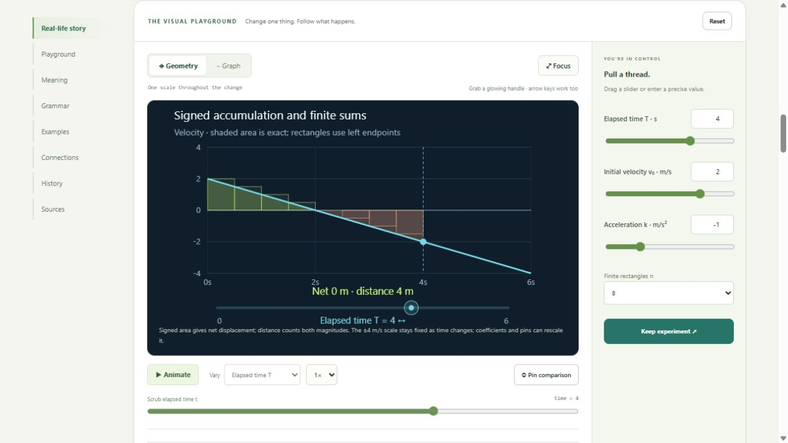

# Validation — 0.15.0

Checked on 2026-10-26. These checks establish implementation behavior and content
parity. They do not constitute independent mathematical, historical, learner,
or assistive-technology review.

## Release inventory

| Item | Count |
|---|---:|
| Draft teaching cards / practical stories | 22 / 22 |
| Worked examples | 114 |
| Numeric fixtures | 161 |
| Source records | 29 |
| Geometry / Graph / distinct 3D views | 22 / 22 / 3 |
| Static BOH documents | 136 |
| Coverage rows / draft specimens / planned entries | 188 / 22 / 166 |

## Automated checks

| Check | Result |
|---|---|
| `node --test tests/*.test.mjs` | 479 passed; zero failures, skips or todos |
| `python tools/check.py` | Five pipeline tests pass; schema/reference/AST checks, 161 numerical cases, eight negative mutations, deterministic payload-preserving exports and pinned static BOH metadata pass |
| Four new mathematical families | Domains, defaults, signed/zero coefficients, reciprocal/fractional powers, two explicit limit families, signed/absolute integrals, finite-sum error and convergence checked |
| Visual encoding | Function length and power-area scales; integer rectangle topology, signed heights and widths; stable time scale including pins; finite SVG at control boundaries |
| Scene interaction | Keyboard/pointer metadata, namespaced IDs, exact quantities, story-specific rail bounds and safe range intersections |
| Story integration | Nine focused story tests verify every template quantity, assumptions, endpoints, sources, immutable provider data and shared scene parity |
| Shared host | All 22 models register, render distinct Geometry/Graph, preserve selection metadata, and expose numeric-only sweeps; original three retain distinct 3D views |
| Saved context | New module parameters, full precision, string selections, graph views and a nonexistent-limit state round-trip through existing workspace format |
| Existing behavior | Prior notebook, workspace, connection, fractal, chaos, readable-number and representation regression tests pass |

The independent Python fixture computation uses logarithmic power evaluation,
analytic one-sided limits, and endpoint-trapezoid accumulation rather than
reading JavaScript output. The bounded affine velocity family has an exact
midpoint sum; the UI does not present that as a general integration guarantee.

## Local browser checks

Verified the final embedded build on an isolated loopback preview origin. The
user's file tab and private notebook/workspace records were not changed.

| Case | Observed result |
|---|---|
| Limit Graph, jump mode, a=1 | Left/right probes show 0 and 2; central filled point is 1; result explicitly says “does not exist” |
| Shrink h to 0.001 | Probe x-coordinates become 0.999 and 1.001; the two y-values remain 0 and 2 |
| Signed accumulation defaults | Net displacement 0 m, total distance 4 m, left sum 1 m from eight rectangles |
| Change partitions to 32 | Exactly 32 rectangles; left sum becomes 0.25 m; exact displacement and distance remain unchanged |
| Signed-area scale | Default ±4 m/s frame makes both areas visible; caption states that time preserves scale and coefficients/pins can change it |
| Function story handle | Announces 0..4 story range; keyboard End reaches 4; formula trace shows 2×4=8, 8+1=9, f(4)=9 |
| Story reset/navigation | Shared controls reset the story and keep text, trace and scene on the same reading |
| Exponentiation e=−2, b=2 | Power/area 0.25; separate reciprocal 4; Graph has a distinct power curve |
| Exponentiation b=0 | Explicit positive-base domain message replaces the graph; no previous current-point mark remains |
| Browser diagnostics | No warning/error logs during the checked concept interactions |

Saved visual evidence:

## Scope still open

All cards remain draft teaching specimens. New Function interaction is affine,
powers use positive real bases, limits use two explicit known families, and
accumulation uses linear velocity. Historical research, independent review,
learner observation, graph data alternatives, 200% zoom, assistive technology,
physical touch devices and live BOH indexing/retrieval remain open.

The original three cards' stale interaction-review wording is tracked in the
[updated matrices](BUILD_REVIEW_0_15_0.md), without changing their saved model
identities or promoting their review status.
