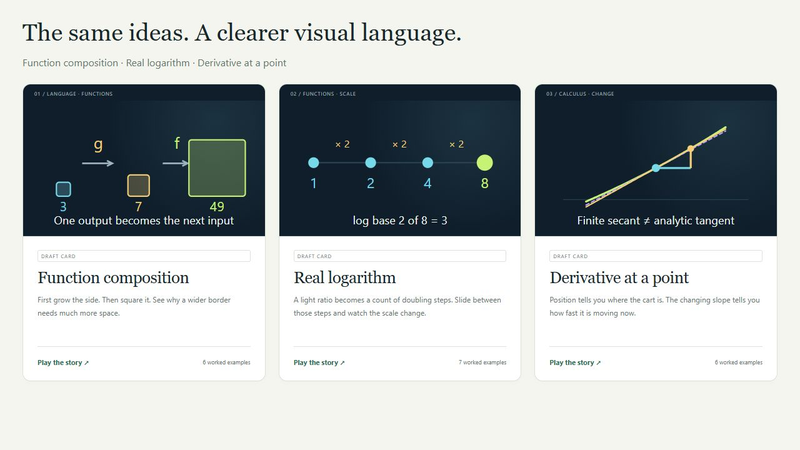
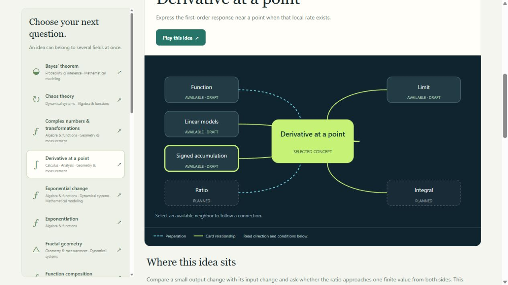

# Validation — 0.16.0

Checked on 2026-10-26. This release updates discovery visuals and interactions
while retaining the 22 concepts, 114 examples, 161 numerical fixtures, 29 source
records, 136 static exports and 47 distinct views from the previous build.

## Automated evidence

| Check | Result |
|---|---|
| `node --test tests/*.test.mjs` | 507 passing tests, zero failures/skips/todos |
| `python tools/check.py` | Five pipeline tests pass, plus schema/reference/AST checks, all 161 numerical cases, eight negative mutations, deterministic complete-payload exports and pinned static BOH metadata |
| Preview provider | All 22 installed IDs covered; current default outputs, finite/scoped/noninteractive SVG, accessible descriptions, composition area ratios, log inversion, secant/tangent distinction, proportions, signed area, probability normalization and finite Koch geometry checked |
| Original mechanics | 3D derivative signed-step grip, authored story bounds, keyboard metadata, tiny areas, continuous exposure cues, explicit undefined domains and preserved original model identities/versions |
| Atlas | All 22 nodes, overlapping fields, canonical directions/reasons/conditions/evidence, correct further-depth direction, planned/external targets, actual availability, keyboard/native selection, filter/URL callbacks and listener cleanup |
| Model data | Exact current-input inclusion, other controls held fixed, all declared output values, units/labels, missing limits, zero secant step with analytic tangent, invalid power domains, discrete selections, bounded sampling, static models and near-one logarithm bases |
| Source browser order | All providers load in the editable entry; all 22 modules retain Graph, and the original three retain distinct 3D views |
| Existing context | Notebook, whole-workspace formats, old saved model versions, pins, views, links, fractal inspection and chaos traces retain their passing regression checks |

All original three content revisions are `0.1.1-draft`. Their review interaction
fields, machine interaction statuses and coverage rows now correctly say
implemented. Their model revision remains `1`; mathematics/history review
status has not been promoted.

## Browser verification

Verified the local embedded build on a separate loopback preview origin. No
user-file-tab records, notebook data or workspace records were changed.

| Scenario | Observed result |
|---|---|
| Atlas direct entry `#atlas/derivative` | Derivative appears in Calculus, Analysis and Geometry; a focused map and readable explanations show its neighborhood |
| Select Real logarithm | Selection and URL update together; Function, Exponentiation and Exponential change are available neighbors |
| Filter Calculus | Chooser narrows to four current concepts and replaces an out-of-field selection consistently |
| Keyboard neighbor activation | Enter on the Limit node opens Limit in the atlas and returns focus to the native chooser |
| Planned neighbors | General Ratio/Integral remain visibly planned; their unavailable identities do not receive card links |
| Narrow render checks | Isolated frames at 390px and 640px exercise actual responsive CSS: narrow Atlas/card layouts and the 640px derivative playground remain usable without cropped card illustrations |
| Card art contact sheet | Composition evaluates 3→7→49, log base 2 of 8 is 3, and finite secant 12.61 is distinguished from analytic tangent 12 |
| Derivative 3D | Both a and h handles present; Home on h reaches −1 and secant 7 while analytic slope stays 12 |
| Derivative h=0 | Finite quotient shows Undefined; analytic slope remains 12; evaluated table preserves both states |
| Open table during animation | Opening pauses/settles the host; during subsequent playback the table stays unchanged with held-reading status; Pause updates the current row |
| Diagnostics | No warning/error console logs during the checked concept interactions |

Responsive frames are a rendering check, not physical-device, touch or genuine
200% browser zoom qualification. Those, assistive technology, and learner
effectiveness remain open. The evaluated table is one numeric slice and does
not replace a complete nonvisual explanation of every 3D/geometric feature.

## Visual evidence

The original three use the same preview provider and styles as Explore:

The working Atlas page shows available and planned neighbors separately:

## Remaining review

All 22 cards remain draft teaching specimens. There are 21 history source gaps
and one partial account. Independent mathematical/history review, learner
walkthroughs, relation-level filters, a multi-concept relation matrix, broader
nonvisual alternatives, physical-device recovery and live BOH ingestion/retrieval
are not completed by these implementation checks. See the
[updated matrices](BUILD_REVIEW_0_16_0.md).
