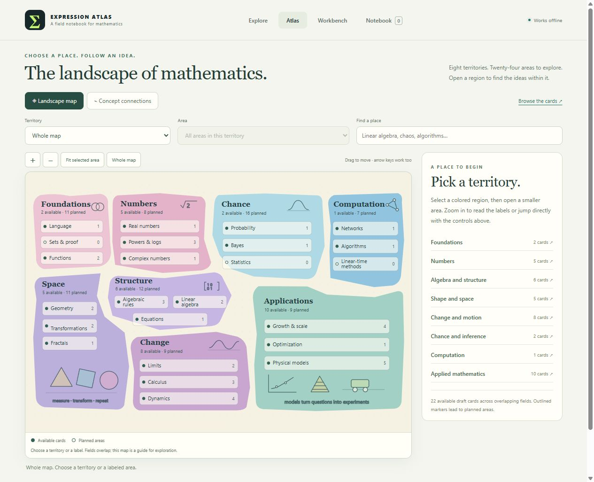
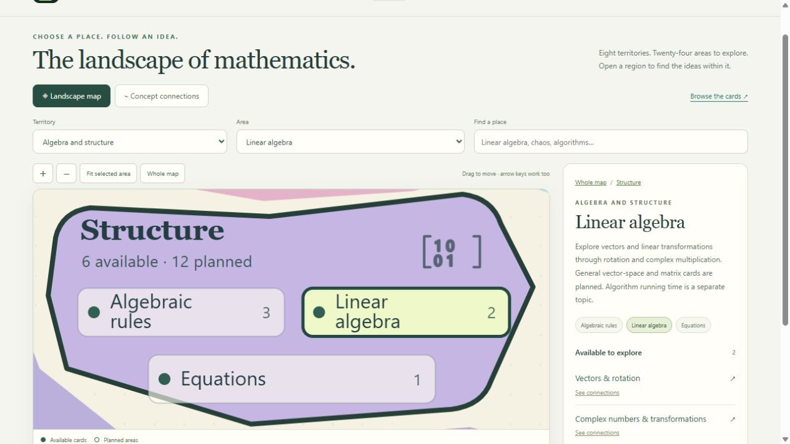

# Validation — 0.17.0

Checked on 2026-10-26. This build adds the selectable landscape and its navigation.
The mathematical collection remains 22 draft cards, 114 examples, 161 fixtures,
29 source records, 136 static exports and 47 distinct representations.

## Automated checks

| Check | Result |
|---|---|
| `node --test tests/*.test.mjs` | 527 pass, zero failures/skips/todos |
| `python tools/check.py` | Five pipeline tests pass, plus schema/reference/AST checks, 161 numeric cases, eight negative mutations, deterministic complete-payload exports and pinned static BOH metadata |
| Region data | Eight regions / 24 topics, all 22 cards covered, 80 actual planned coverage concepts, immutable projections, deduplicated counts and actual-card availability |
| Search meaning | Linear algebra and Linear-time algorithms remain distinct results; the latter has no available lesson |
| Artwork | Eight region and 24 topic controls, descriptions, namespaces, selection state, finite camera bounds and separate decorative geometry |
| URLs | Whole map, region, topic and every old concept link round-trip; card placement resolves to an area containing that actual lesson |
| Controller | Native selection, search focus, URL notifications, bounded camera movement, context-relevant connections and delegated neighborhood cleanup |
| Pointer regression | Blank-map drags do not swallow later toolbar actions; released/inherited pointer events cannot resume a ghost drag |
| Motion | Reduced-motion selection is immediate; pending camera work and preference listeners are removed on cleanup |
| Offline order | New providers load in the source entry alongside existing models, scenes, stories, workspace and graph APIs |

## Targeted browser checks

Used a separate local preview origin. The user's file tab and private records
were not changed.

| Scenario | Observed result |
|---|---|
| Plain Atlas entry | Opens the whole landscape, with available/planned markers and native territory/area controls |
| Click Linear algebra | Camera settles to its territory bounds; panel lists Vectors & rotation and Complex numbers & transformations |
| Search linear algorithms | Exactly the two intended results appear, and the input retains focus |
| Choose Linear-time algorithms | Shows planned context, no working lesson links, and a shareable computation-area URL |
| Native territory/area controls | Select regions/topics and update the URL consistently |
| Computation → Connections | Opens Graph theory & shortest paths, keeping the selected territory relevant |
| Return to Landscape | Restores map context and preserves its distinct navigation mode |
| Pointer drag | Camera pans while Linear algebra remains selected; the subsequent zoom button works on its first click |
| Keyboard selection | Enter on Powers and logarithms selects that area and keeps focus on its map hotspot |
| Card placement | Function composition's Place on map opens Function rules with both Function and Function composition lessons |
| 390px / 640px frames | Native controls reflow and remain available; selected-area layout renders at narrow widths |
| Diagnostics | No warning/error console messages during the checked app interactions |

Narrow frames verify responsive rendering, not physical touch devices, pinch
gestures, assistive technology or genuine 200% browser zoom. The geography is
editorial navigation, not a mathematical dependency theorem or complete taxonomy.

## Visual evidence

The user's supplied reference informed the landscape direction. The application
uses original code-native SVG regions and motifs; the reference bitmap is not
bundled as an application asset. Existing mathematical and historical review
gaps remain documented in [the updated matrices](BUILD_REVIEW_0_17_0.md).
