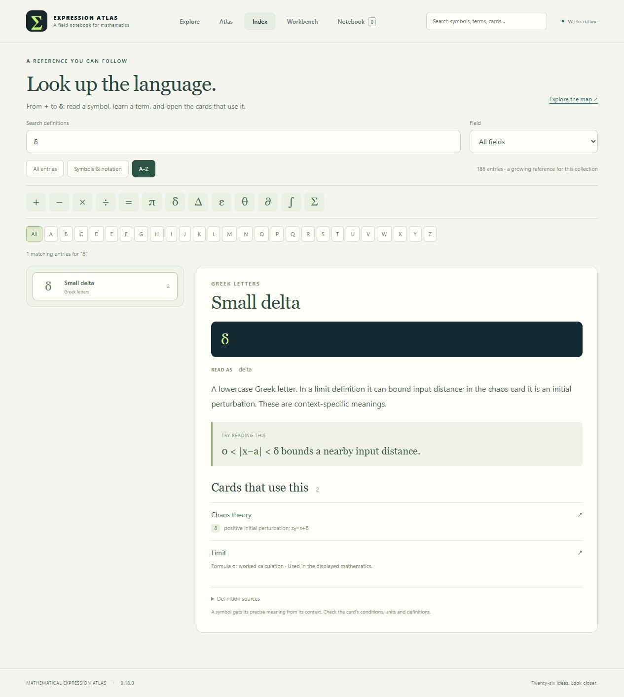
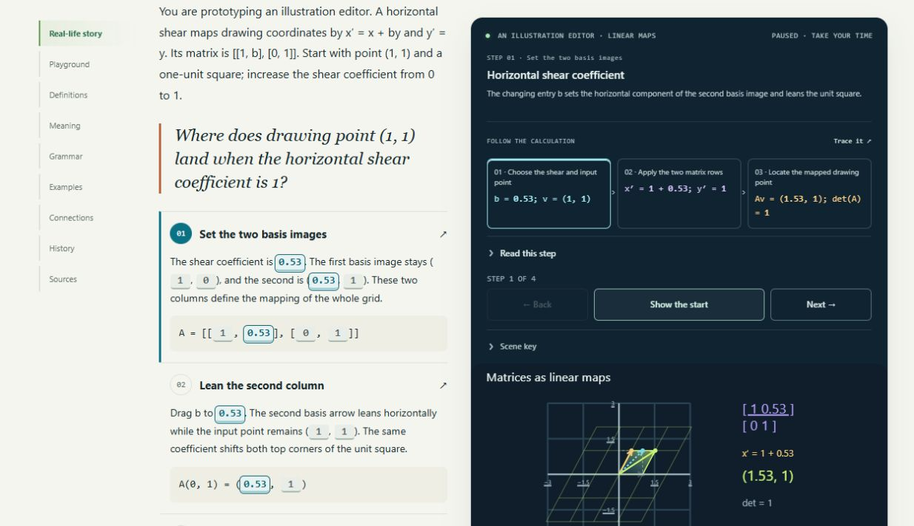
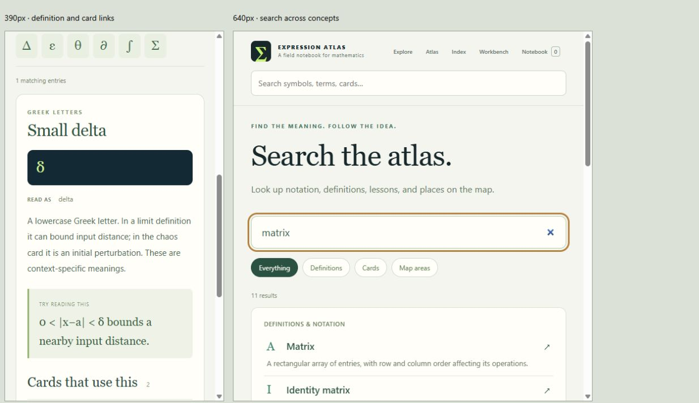

# Validation — 0.18.0

Checked on 2026-10-26. The collection now has 26 draft cards, 134 worked examples,
202 numeric fixtures, 33 canonical source records and 160 static BOH exports.
There are 55 views: 26 Geometry, 26 Graph and the original three genuine 3D views.
The index projects 186 entries: 174 authored definitions and 12 exact-notation
entries. This release does not establish independent mathematical review,
historical priority, teaching effectiveness or live BOH compatibility.

## Automated checks

| Check | Result |
|---|---|
| `node --test tests/*.test.mjs` | 567 pass, zero failures/skips/todos |
| `python tools/check.py` | Five pipeline tests pass, plus schema/reference/AST checks, all 202 numeric fixtures, eight negative mutations, deterministic complete-payload exports and pinned static BOH metadata |
| New linear models | Twenty focused model/story tests cover independent arithmetic, zero vectors, undefined projections, signed determinants, singular maps, distinct graphs, exact scene quantities, presets and provider-owned input bounds |
| Linear integration | All four cards register through the same host, each preview matches evaluated defaults, and typed area factors remain distinct from length scale factors |
| Index | All current grammar tokens have local usage contexts; 24 lowercase Greek letters are individually searchable; δ/Δ/∂ remain distinct; exact single-letter use avoids prose substring matches |
| Formula matching | TeX command boundaries distinguish `\le` from `\left` and `\in` from `\infty`; formula contexts retain the notation actually matched |
| Shared search | Symbol names and typed operator variants reach real cards; scoped variables preserve their exact context; definitions, cards and areas have separate working destinations |
| Lifecycle | Input nodes remain stable during search; empty results recover; Escape closes suggestions even when it restores input focus; outside listeners and page controllers clean up |
| Atlas availability | All 26 cards appear in 24 areas across eight territories; 77 unique planned concepts are represented; Linear algebra has six available cards |
| Offline loading | New models, stories, reference data, search and styles are embedded in the standalone entry in dependency order |

Two stale assertions surfaced after updating the map description: one still
called matrix cards planned, and another read the letters “nan” inside
“determinants” as a non-finite numeric value. The first now verifies the four
available card links and actual remaining topics; the numeric guard checks
whole tokens. The complete suite passes with both corrections.

## Targeted browser checks

Used a separate preview tab and local origin. The user's file tab and private
notebook/workspace records were not edited.

| Scenario | Observed result |
|---|---|
| Header `+` and ASCII `-` | Definitions and cards using the operations appear |
| δ and Δ | Lowercase delta leads to Chaos and Limit; capital delta leads to Derivative and Signed accumulation |
| Header Enter | Opens the full results page and transfers focus to its input |
| Popup Escape from a result link | Closes suggestions and returns focus without reopening the popup |
| Definition link and reload | Selected definition and notation query survive the URL round trip |
| Field filter with no result | Honest empty state; Clear search restores browsing |
| A–Z | D filters the entry list to names beginning with D; common-symbol buttons recover a direct lookup |
| Matrix Geometry and Graph | Geometry shows the transformed grid and point; Graph shows mapped horizontal output versus b |
| Matrix keyboard/pointer input | Arrow keys update the handle and result; native dragging moves the coefficient continuously |
| Matrix story | Selecting b highlights text, formula and its scene marks; changes propagate through the row calculation to the output point |
| Determinant d = −1 | Signed factor is −1, area magnitude is 1, orientation is reversed |
| Determinant d = 0 | Valid collapsed scene and zero output |
| Dot product with u = (0,0) | Dot product remains zero; projection and angle explicitly state undefined direction |
| Vector (0,0) | Length zero, with no direction angle |
| Per-card vocabulary | Opens definitions used by that card; exact local notation retains context in the destination |
| Place on map | Linear algebra lists Vectors, Dot product, Matrix linear maps and Determinant alongside the two existing lessons |
| 390px / 640px frames | Header search and index controls reflow; the narrow definition is readable in one column and full-search filters remain available |
| Diagnostics | No warning/error console messages during the checked interactions |

Direct browser automation of `file://` was blocked by the browser tool's URL
policy. No alternate browser route was used to bypass that block. Interface
observations above use the local HTTP preview; standalone embedding and ZIP
parity are automated checks. Opening the final file directly remains a manual
qualification step.

Narrow frames check responsive rendering, not physical touch devices, assistive
technology or genuine 200% browser zoom. Search uses bounded local matching,
not semantic proof or exhaustive parsing of every mathematical sentence.
The new modules illustrate bounded real 2D models. Review and qualification
gates remain open in [the updated matrices](BUILD_REVIEW_0_18_0.md).

## Visual evidence

