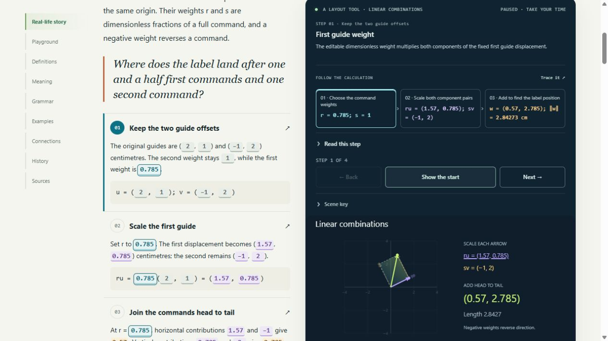
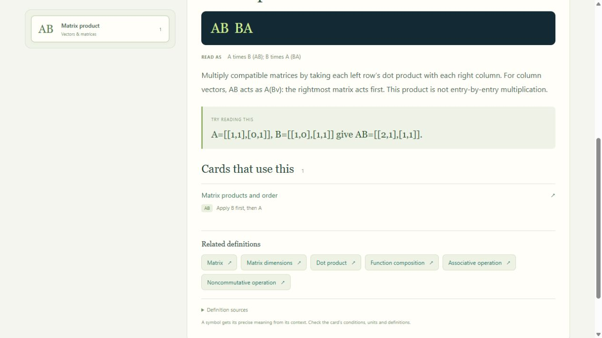
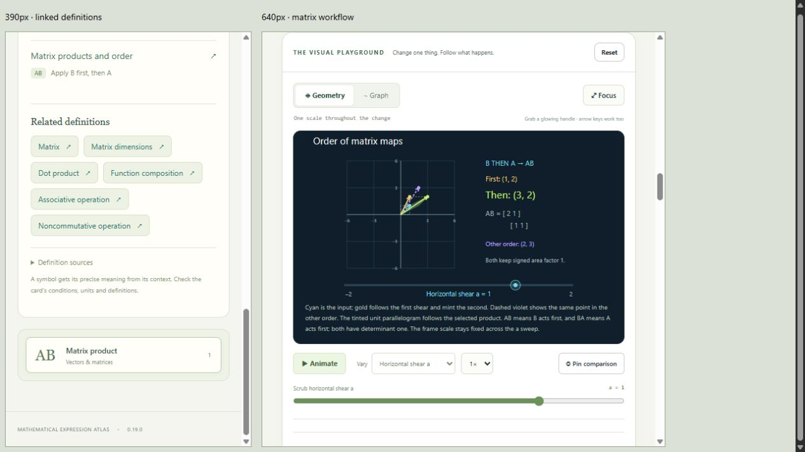

# Validation — 0.19.0

Checked on 2026-10-26. The collection has 29 draft cards, 149 worked examples,
238 numeric fixtures, 37 canonical source records and 178 static BOH documents.
There are 61 views: 29 Geometry, 29 Graph and the original three genuine 3D views.
The index has 213 entries: 194 authored definitions and 19 exact-notation entries;
35 authored entries supply Related definitions groups. These figures measure
implemented draft breadth, not independent mathematical or historical review.

## Automated checks

| Check | Result |
|---|---|
| `node --test tests/*.test.mjs` | 597 pass, zero failures/skips/todos |
| `python tools/check.py` | Five pipeline tests pass, plus schema/reference/AST checks, 238 numeric fixtures, eight negative contract mutations, deterministic complete-payload export and pinned static BOH metadata |
| Workflow providers and stories | 18 focused tests cover exact arithmetic, both matrix orders, basis rank/solution classes, numeric range, bounded/clipped drawings, pins, unique SVG IDs and story bounds |
| Canonical runtime parity | All 36 new fixtures match registered provider status/output; all 15 new worked examples have valid presets |
| Independent arithmetic | Python checks weighted vectors through complex coordinates, basis coordinates through pivoted elimination, and composition through full matrix multiplication |
| Nullable outputs | A valid dependent-basis configuration retains null coordinates rather than inventing zero values; null fixtures are admitted explicitly by schema |
| Workspace continuity | Dependent basis and reversed matrix-order settings round-trip through a portable workspace record, preserving their selected Graph views and exact revision 1 |
| Explicit connections | Basis coordinates can drive scalar weights when unique; unavailable source coordinates remain blocked; vector components retain their own declared type |
| Reference data | 20 new authored definitions, valid immutable related IDs, actual card vocabulary links and exclusion of incidental metadata/control keys |
| Exact notation | AB/BA outrank English substrings and scope their usage to exact notation; matrix size, rank and vector-space dimension remain distinct definitions |
| Search areas | Notation reaches map areas containing actual card usage; AB does not produce Probability merely because its name contains the same letter fragment |
| Atlas and views | All 29 cards represented across 24 areas/eight territories; nine available Linear algebra cards; 75 distinct planned inventory concepts mapped |
| Offline source order | New providers and stories load before routing, all modules render both views in the source entry, and all scripts/styles/content embed in the standalone application |

Existing module identities and revisions remain unchanged. The previous
26-card collection's fixture tests remain in the full suite.

## Targeted browser checks

Used a separate preview tab and local HTTP origin. The user's file tab and
private notebook/workspace records were not edited.

| Scenario | Observed result |
|---|---|
| Matrix default and reversed order | B then A gives intermediate (1,2), final (3,2); A then B gives intermediate (2,1), final (2,3) |
| Matrix Graph | Selected and opposite-order curves are distinct and share the displayed scale |
| Basis default | Target (3,2) reconstructs with weights r=1, s=2 in the displayed ordered basis |
| Dependent basis, target outside span | Scene explains no solution; Graph shows a gap and an explicitly input-only handle |
| Dependent basis, target on span | Scene states infinitely many coefficient pairs and displays no unique coordinates |
| Near-dependent basis | For target (1,0), columns (1,1) and (1,1.015625) give r=65, s=−64; long arrows are explicitly clipped while actual values stay readable |
| Linear combination story | Selected r is highlighted in text, component products, calculation phases and the changing head-to-tail sum |
| Native drag | Dragging the r handle updates the precise numeric control and the resulting geometry; Graph remains a separate representation |
| Exact AB search | Returns the Matrix product definition, the actual matrix-order card and Linear algebra area, with no unrelated letter-fragment hits |
| Definition scope | The AB reference lists its local rightmost-first meaning and one actual card use |
| Related definitions | Matrix dimensions opens directly; browser Back restores the AB query and definition |
| 390px / 640px frames | Related-definition links wrap without horizontal overflow; the workflow scene and common controls reflow at the narrower widths |
| Diagnostics | No warning/error console messages during the checked interactions |

The scene/readout/Graph boundaries are explicit: the basis geometry uses a fixed
±4 frame; very large coordinates retain readable actual values and bounded
rendering. Graph coordinates beyond ±1,000,000 are omitted with an explanation.
Matrix composition is restricted to the two declared shear families and its
order selector is discrete. Constructed stories are not measured system data.

Browser observations use the local preview. Direct file opening, physical touch
devices, assistive technology, genuine 200% zoom and learner comprehension still
need qualification. The existing browser tool's HTTP-only URL boundary is not
bypassed for file testing. BOH checks are static metadata/export checks; no live
ingestion or retrieval claim is made. See [the updated matrices](BUILD_REVIEW_0_19_0.md).

## Visual evidence

