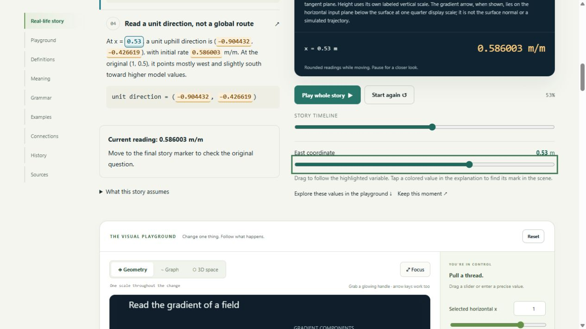
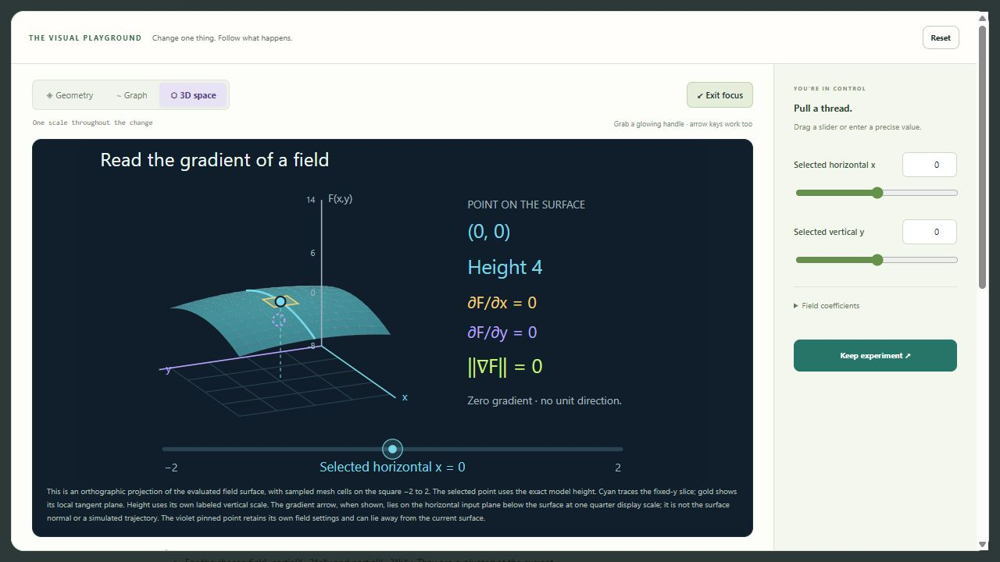
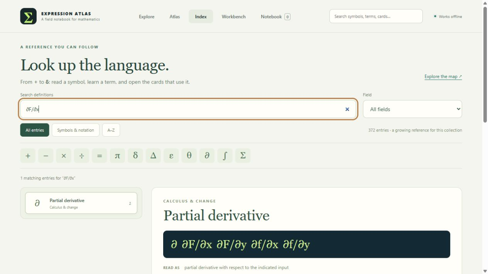
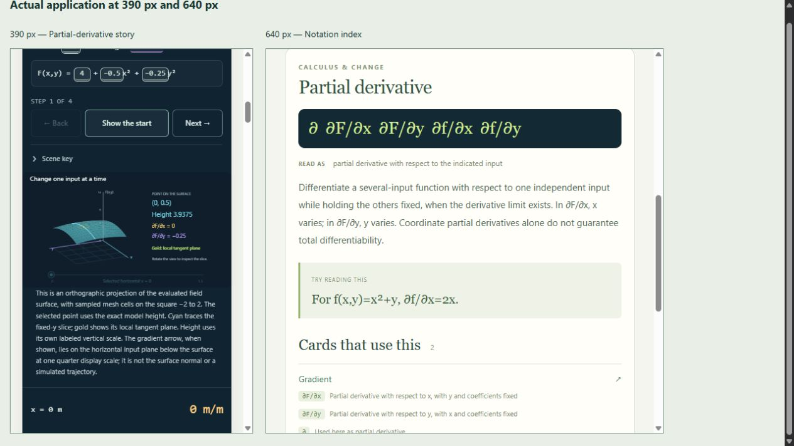

# Validation — 0.20.0

Checked on 2026-10-26. The collection has 32 draft cards, 164 worked examples,
274 numeric fixtures, 40 canonical sources and 196 deterministic BOH documents.
There are 69 declared views: 32 Geometry, 32 Graph and five genuine 3D views.
The index has 372 entries: 352 authored definitions and 20 contextual readers.
These counts describe implemented draft breadth; independent mathematical and
historical review remains open.

## Notation before expansion

The current-app/common-reference gate was completed before the three new
concepts were authored. The preserved [baseline report](NOTATION_GATE_BEFORE_EXPANSION.json)
records 29 cards, 355 index entries, 23,991 occurrences and 795 distinct forms,
with zero unresolved cases or callable-expression reviews.

The [expanded report](NOTATION_COVERAGE_0_20_0.json) resolves all 29,760
mathematical occurrences across 826 distinct normalized forms, with zero
unresolved forms or callable reviews. It checks canonical expressions,
worked mathematics, story formulas and units, generated scene/readout labels at
declared control boundaries, and the reference examples and symbols. Its exact
counts are generated by `node tools/check_notation.cjs`. This is a finite
coverage contract, not a claim to include every notation used in mathematics.
The only UI exclusion is the explicitly recorded horizontal drag-hint suffix
on foundations rails; mathematical relations remain in scope.

## Automated checks

| Check | Result |
|---|---|
| `node --test tests/*.test.mjs` | 644 pass, zero failures/skips/todos |
| `python tools/check.py` | Five pipeline tests pass, plus schema/reference/AST validation, all 274 fixtures, eight negative contract mutations, deterministic export and pinned static BOH metadata |
| Calculus providers and stories | Boundary, camera, mesh, pin, exact arithmetic, stationary/flat/saddle cases, safe rendering and story-domain regressions pass |
| New canonical examples | All 36 numeric cases and all 15 example presets match the registered models |
| Independent numerical arithmetic | Python checks chain-rule results using an expanded polynomial; quadratic coordinate slopes use symmetric differences independently of the JavaScript derivative expressions |
| Semantic scene marks | Every bound canonical grammar quantity has a real rendered mark; the partial lesson distinguishes its selected x tangent from the separate y partial |
| Story view routing | Declared surface views pass through the generic story host and scene router; legacy callers retain their Geometry default |
| Portable workspace | Spatial view, camera, comparison pin and a zero-gradient state round-trip; zero norm remains valid while normalized direction components stay null |
| Explicit port types | A gradient norm cannot silently become a scalar calibration setting; a derivative cannot silently become a coordinate |
| Notation meaning | Greek case, vector projection components, exact apostrophe/TeX lookups, units and locally scoped letter meanings have regression coverage |
| Atlas and offline assembly | All 32 cards have placements across eight territories and 24 areas; 74 distinct planned concepts are mapped; new providers load before consumers and embed in the standalone app |

Existing module identities and revision 1 records remain compatible. The two
field lessons share one pure analytic evaluator for `F=c+ax²+by²`, with distinct
primary quantities. Chain rule uses `g(x)=ax+b` and `f(u)=u²`. These bounded
families are stated on the cards and are not arbitrary symbolic engines.

## Browser observations

Checked the assembled application in a separate local HTTP preview tab. The
user's file tab and private notebook/workspace records were not edited.

| Scenario | Observed result |
|---|---|
| Gradient story | The selected x appears in story text, calculation phases and the same 3D surface point; an arrow-key move updates height, both partials, norm and unit direction coherently |
| Actual surface view | Stories use the declared orthographic surface, rather than falling back to the contour view |
| Zero gradient | At (0,0), height is 4, both partials and norm are zero, and the scene says no unit direction; the pinned original point remains separate |
| Camera and drag | Changing the spatial angle leaves the mathematics unchanged; a native drag moves the selected x and updates the exact numeric control and gradient readings |
| Graph | Gradient Graph labels its nonnegative norm as distinct from height and retains the pinned comparison curve |
| Chain-rule story | Final x=1 gives side 3 m, area 9 m², derivative factors 2 and 6, and sensitivity 12 m² per unit setting |
| Signed chain-rule model | Changing the inner multiplier to −2 at x=1 gives inner value −1 and factors −2, −2, producing derivative 4; the physical story retains its positive-side domain |
| Exact lookup | `\Delta` returns capital delta, `δ` returns small delta, `f'(a)` reaches Derivative at a point, and `∂F/∂x` reaches the two field cards |
| View vocabulary | Tangent plane links to both field cards from their authored view descriptions; a followed link opens the correct calculus card and mathematical setting |
| Narrow layout | Actual app frames at 390px and 640px show wrapped story/reference text and a fitted surface without visible horizontal clipping |
| Main preview diagnostics | No warning or error console messages during the checked main-app interactions |

Numbers use the existing moving/settled pacing and stable text updates. These
observations check behavior and layout; they do not substitute for learner
comprehension or physical-device accessibility testing. Direct file opening,
assistive technology, genuine 200% browser zoom, touch hardware and broader
offline/recovery scenarios still need qualification. The browser tool's
HTTP-only boundary was respected. BOH verification remains static export and
metadata lint, without a live ingestion or retrieval claim.

See the [three updated matrices](BUILD_REVIEW_0_20_0.md),
[notation contract](SYMBOL_NOTATION_COVERAGE.md),
[index contract](MATH_INDEX.md), and [module contract](PLAYGROUND_MODULES.md).

## Visual evidence

