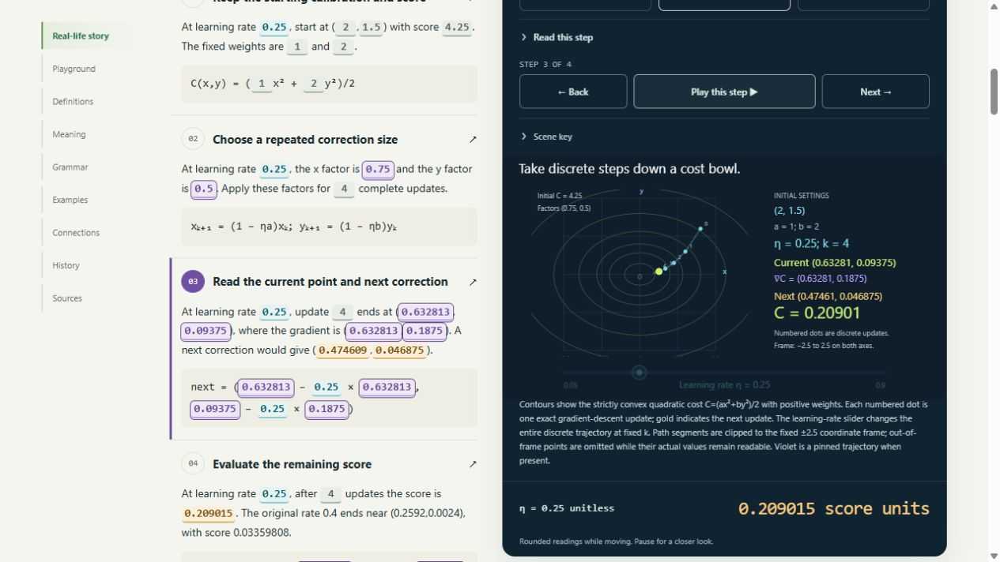
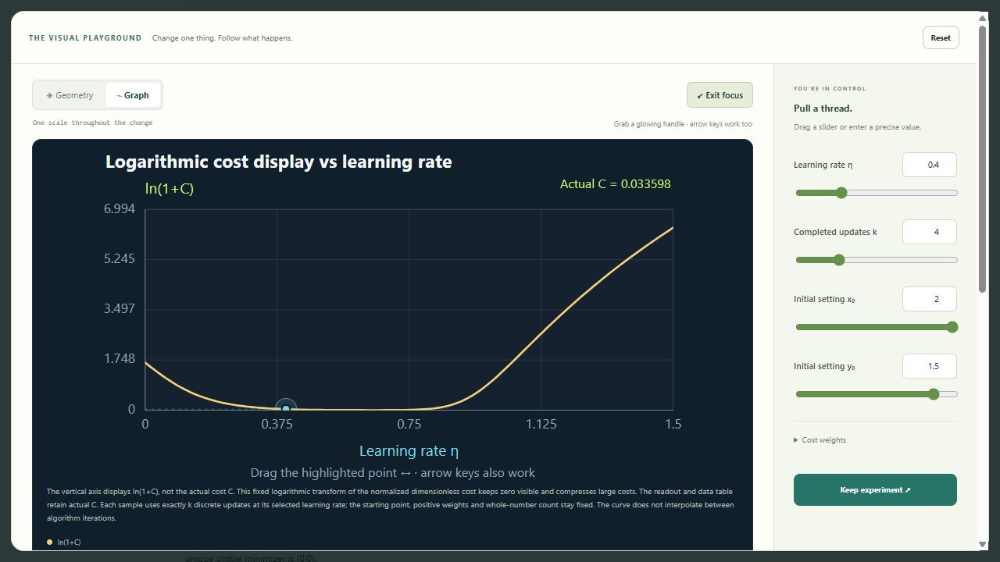
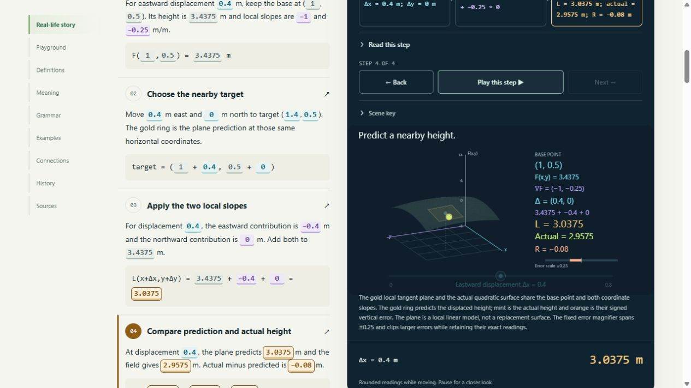
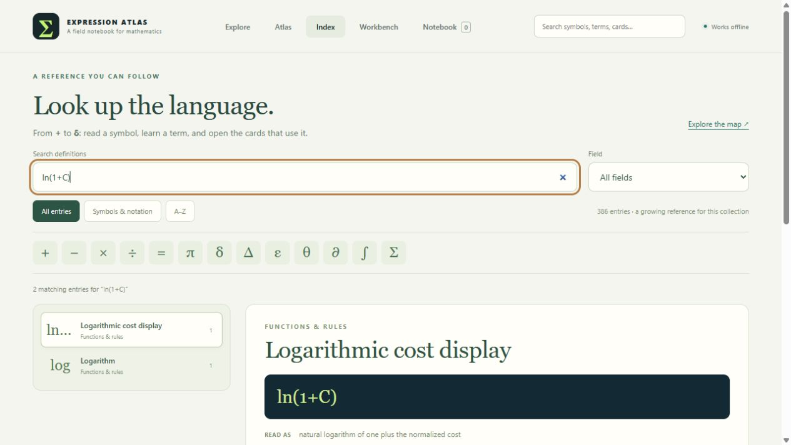
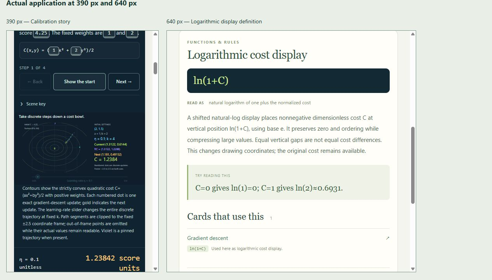

# Validation — 0.21.0

Checked on 2026-10-26. The collection contains 35 draft cards, 179 worked
examples, 310 numeric fixtures, 42 canonical sources and 214 deterministic BOH
documents. There are 77 views: 35 Geometry, 35 Graph and seven genuine Spatial
views. The index has 386 entries: 366 authored definitions and 20 contextual
readers, with 219 related-definition groups.

Directional derivative, Tangent plane and Gradient descent form this batch.
The first two reuse the existing quadratic-field evaluator and projection
helpers. Descent maps a positive quadratic objective through the same evaluator.
The common playground retains motion, readable values, controls, pins and saved
configuration; no topic-specific animation engine or host branch was added.

## Automated verification

| Check | Result |
|---|---|
| `node --test tests/*.test.mjs` | 674 pass; zero failures, skips or todos |
| `python tools/check.py` | Five pipeline tests pass, with schema/reference/AST checks, 310 numeric fixtures, eight negative contract mutations, deterministic complete-payload export and pinned static BOH metadata |
| New provider, stories and content | All 36 new fixtures and 15 worked-example presets agree with the registered model; boundary cases, 120-frame story paths, cameras, pins and finite clipped drawings pass |
| Independent arithmetic | Python uses centered quadratic differences for directional rates and plane slopes, and a closed-form power solution to check JavaScript's repeated descent updates |
| Discrete update contract | Fractional update counts are rejected; an integer count change does not interpolate through invalid states. Continuous step-size changes retain smooth motion |
| Shared story routing | Both new surface stories reach the real Spatial provider through the existing story route |
| Semantic marks | Canonical grammar bindings resolve to visible quantities, keeping vectors, scalar rates, predictions, actual heights and signed errors distinct |
| Tangent error cue | A fixed ±0.25 magnifier reveals small signed errors; larger errors explicitly clip the bar while retaining their actual readings |
| Shifted-log Graph | Only the descent Graph ordinate uses `logCost=ln(1+C)`. Exact tests cover zero, ordinary and large costs, transformed pins and the separate actual-C mark. Output, curve values, data tables and ports retain actual cost |
| Portable workspace | Integer updates, oversized step sizes, Spatial view, camera and comparison pins survive backup restoration with unchanged revision contracts |
| Search semantics | Exact cost, gradient, linearization, residual, subscript and shifted-log searches reach actual cards, without unrelated binomial or generic-notation ownership |
| Mathematical case | Scrubber labels, fallback descriptions and model-data text preserve Δx and other case-sensitive symbols |

The [notation report](NOTATION_COVERAGE_0_21_0.json) resolves **36,609
occurrences across 876 distinct normalized forms**, with zero unresolved forms
and zero callable reviews. It checks 22,182 selected fields, including 20,172
public runtime fields and 874 reference fields; 751 formatting occurrences are
classified separately. The 58 explicitly recorded UI exclusions remain the
foundations' horizontal-drag hint suffix. The
[sealed baseline](NOTATION_GATE_BEFORE_EXPANSION.json) and
[previous checkpoint](NOTATION_COVERAGE_0_20_0.json) remain unchanged.

This is the finite [notation coverage contract](SYMBOL_NOTATION_COVERAGE.md),
not a claim to include every notation used in mathematics.

## Browser observations

Used a separate local HTTP preview. The user's file tab and private records were
not edited.

| Scenario | Observed result |
|---|---|
| Chosen direction | At the same hill point, east gives slope −1 and west gives +1; the unit-direction components, two products, sum and surface reading change together |
| Tangent-plane story | At Δx=0.4, Δy=0, prediction is 3.0375 m, actual height is 2.9575 m and signed error is −0.08 m; the orange magnifier makes the small gap visible |
| Descent story | At η=0.25 and k=4, the current point is (0.6328125,0.09375), with cost 0.209014892578125; story tokens, next correction and numbered path share that state |
| Whole update count | Changing k from four to five at η=0.4 gives (0.15552,0.00048), with finite cost about 0.0120935; no fractional-update scene appears |
| Oversized step | At η=1.5 and k=5, the current point is (−0.0625,−48). Its actual cost stays readable while the scene explicitly says the point is outside the fixed frame |
| Direct drag | Dragging the scene learning-rate handle changes η from 0.4 to about 0.679434 while keeping k=4; coordinates, gradient, cost and numbered path update coherently |
| Descent Graph | Explicit ln(1+C) labeling reveals improvement and large-step growth together; the separate actual-C callout remains readable |
| Exact index lookup | `ln(1+C)` opens the shifted-log definition and links to Gradient descent, with related definitions retained |
| Narrow layout | Actual app frames at 390px and 640px show a fitted descent scene, wrapping story values, readable main output and the linked definition without visible horizontal clipping |
| Main preview diagnostics | No warning/error console messages during the checked main-app interactions |

The iframe layout harness reported a MutationObserver error while its content
rendered. That check supports the visual observations above, not a claim that
the harness ran without diagnostics. Physical touch hardware, assistive
technology, genuine 200% browser zoom, fresh-profile recovery and direct file
opening still require qualification. The browser tool's HTTP-only boundary was
respected. BOH checks remain static export/metadata checks, not live ingestion
or retrieval verification.

## Mathematical and visual boundaries

The field is the declared family `F=c+ax²+by²`, with perpendicular equally scaled
coordinates. Directional rates use unit directions. A tangent plane is local;
its exact remainder here is specific to this quadratic family.

Descent uses `C=(ax²+by²)/2` with positive weights. Its numbered points are exact
discrete updates. The all-start contraction condition `0<η<2/max(a,b)` belongs
to this family; an initial point with no component along an unstable axis can
behave differently at other rates. Drawings clip to a fixed coordinate frame
without clipping the underlying values. The shifted-log display requires a
nonnegative normalized dimensionless cost and makes vertical distances
nonlinear; it does not silently transform physical units or the primary output.

All stories are constructed teaching scenarios. Draft breadth and successful
fixtures do not replace independent mathematical, historical or pedagogical
review. See the [three updated matrices](BUILD_REVIEW_0_21_0.md).

## Visual evidence

