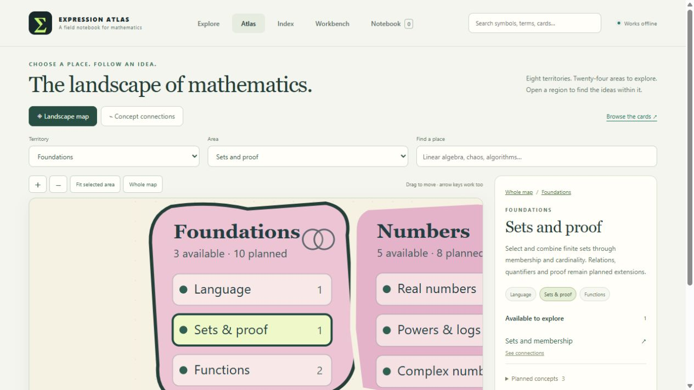
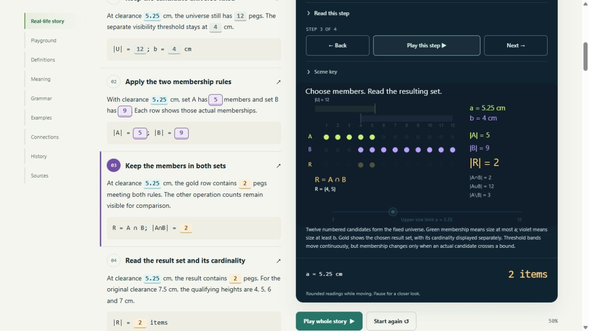
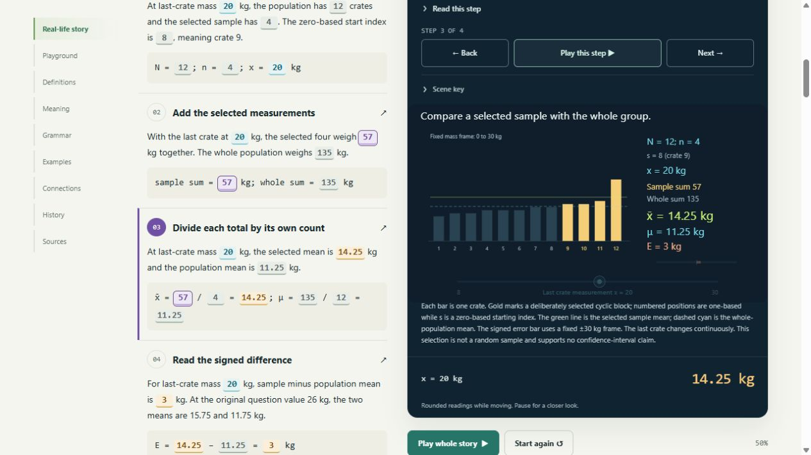
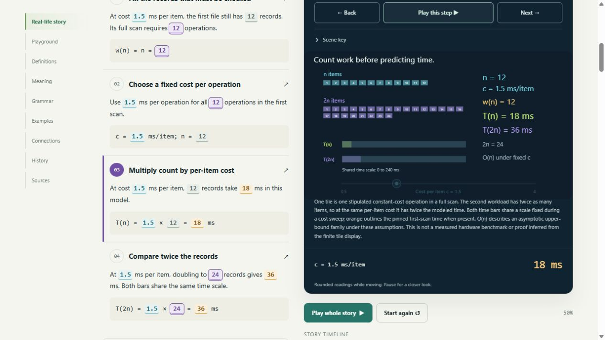
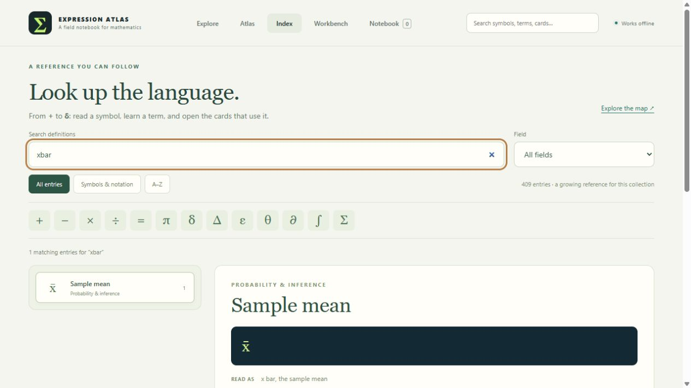
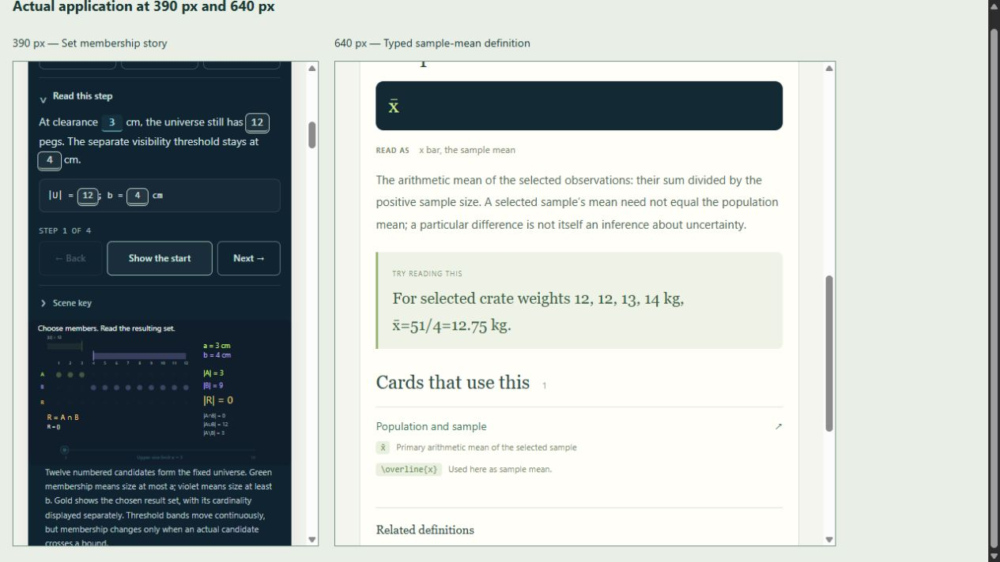

# Validation — 0.22.0

Checked on 2026-10-26. This expansion prioritizes the atlas's three previously
empty areas. Each now has an introductory lesson, giving all 24 areas at least
one available card. This is minimum introductory availability, not completion
of the mathematical fields or their planned concepts.

| Area | Previously available | New lesson | Now available |
|---|---|---|---|
| Sets and proof | 0 | Sets and membership | 1 |
| Statistics | 0 | Population and sample | 1 |
| Linear-time algorithms | 0 | Computational complexity: a linear scan | 1 |

The collection contains 38 draft cards, 194 worked examples, 346 numeric
fixtures, 47 canonical sources and 232 deterministic BOH documents. There are
83 views: 38 Geometry, 38 Graph and seven genuine Spatial views. The reference
has 409 entries: 389 authored definitions and 20 contextual readers, with 243
related-definition groups. The inventory retains 192 rows: 38 draft specimens
and 154 planned concepts; 70 distinct planned concepts are mapped.

## Automated verification

| Check | Result |
|---|---|
| `node --test tests/*.test.mjs` | 702 pass; zero failures, skips or todos |
| `python tools/check.py` | Five pipeline tests pass, including schema/reference/AST validation, 346 fixtures, eight negative contract mutations, deterministic complete-payload export and pinned static BOH metadata |
| New content and models | All 36 new numeric cases and 15 original example presets agree with the actual registered provider |
| Independent numerical checks | Python counts integer bounds rather than replaying the set filters, rotates and sums the population for sample means, and adds a per-item cost for each inspection rather than multiplying |
| Story continuity | Complete 120-frame paths remain valid; selected quantities, formulas, units and scene marks resolve against the same model state |
| Finite-set boundaries | Inclusive cutoffs, all three operations, empty results and set/count identities are checked; continuously moving thresholds do not invent fractional members |
| Sample selection | Cyclic selections contain distinct valid indices; sample count and start index remain discrete while the highlighted measurement varies continuously |
| Census invariant | Selecting all twelve observations produces exactly the population sum/mean and zero signed error across all twelve starting indices and four fractional measurements, without changing displayed sample order |
| Explicit modular connection | A set cardinality of four can drive a four-item scan, predicting 8 ms at 2 ms/item. Portable workspace restoration retains this directed connection and both views. A zero result is rejected by the scan's declared positive-count bound |
| Notation roles | Set objects differ from their cardinalities; contextual bars do not become absolute values. Sample mean, population mean, summation, Big-O and Big-Theta retain distinct meanings and scoped card links |
| Atlas navigation | All 24 areas lead to installed lessons. Linear algebra, the linear-time area and broader Algorithms remain distinct search choices; the filled linear-time area opens its own card |
| Rendering and source order | Both views of every new module render finite bounded graphics with pins and unique IDs. Providers, stories, previews, index and shared host load in the offline entry's declared order |

The new [model provider](../src/atlas-gaps.js) and
[story provider](../src/atlas-gap-stories.js) use the existing registry, motion,
number pacing, controls, semantic links, comparison and saved-workspace contracts.
They own no clocks or DOM state. Older model identities and revisions remain
unchanged. These three lessons use Geometry and Graph; no artificial 3D view was
added for topics that do not need one.

## Notation gate

The [current report](NOTATION_COVERAGE_0_22_0.json) resolves **39,023 occurrences
across 916 distinct normalized forms**, with zero unresolved forms and zero
callable reviews. Its 23,794 selected fields include 21,602 public runtime
fields and 929 reference fields. There are 796 classified formatting
occurrences. The 58 explicitly recorded UI exclusions remain the foundations'
horizontal-drag hint suffix.

The [sealed baseline](NOTATION_GATE_BEFORE_EXPANSION.json),
[0.20.0 checkpoint](NOTATION_COVERAGE_0_20_0.json) and
[0.21.0 checkpoint](NOTATION_COVERAGE_0_21_0.json) remain unchanged. This follows
the finite [coverage contract](SYMBOL_NOTATION_COVERAGE.md), not a claim to
include every notation used in mathematics.

## Browser observations

Checked the assembled application through a separate local HTTP preview. The
user's file tab and private notebook/workspace records were not edited.

| Scenario | Observed result |
|---|---|
| Formerly empty area | Sets and proof shows one available lesson and a working card link; the atlas also reports Statistics and Linear-time algorithms with one each |
| Set story | At a=5.25 cm and b=4 cm, A has five members, B has nine, and the intersection contains {4,5}, cardinality two. Story text, formula and colored membership rows agree |
| Operation selector | With the playground defaults a=7.5 and b=4, union returns all twelve candidates, while A∖B returns {1,2,3}; the displayed set and count change together |
| Sample story | At highlighted mass 14 kg, the chosen four sum to 51 kg and average 12.75 kg. All twelve sum to 129 kg and average 10.75 kg, giving signed difference 2 kg |
| Whole population | After entering mass 14.1234567 kg, sample size twelve and start index eleven, both displayed means agree and E is exactly zero |
| Scan model | At c=2 ms/item and n=24, work is 24 inspections, T(n)=48 ms and T(2n)=96 ms. Separately, c=0 with n=12 gives zero predicted times while retaining twelve inspections |
| Separate Graph | The scan Graph shows both exact time predictions as per-item cost changes at fixed whole-number n; its caption explicitly excludes measured-runtime and finite-plot complexity claims |
| Exact lookup | `|R|` opens Cardinality with the Set card as its actual use, while Absolute value remains a distinct possible reading. `xbar` reaches Sample mean and the population card; `O(n)` reaches Big-O and the scan card |
| Narrow layout | Actual app frames at 390px and 640px show wrapped set-story values, a fitted membership scene and readable mean-definition/card links without visible horizontal clipping |
| Main preview diagnostics | No warning/error console messages during the checked main-app interactions |

Initial automated navigation/snapshot requests sometimes timed out before the
preview finished loading. Subsequent observations confirmed the rendered
content. The narrow-layout check is visual evidence, not performance or
assistive-technology qualification. Direct file opening, genuine 200% zoom,
physical touch hardware, screen-reader use and fresh-profile recovery still
need qualification. The browser tool's HTTP-only boundary was respected.

## Mathematical boundaries

The set model has a fixed universe of twelve numbered peg heights. Its result
is a collection; cardinality counts members and is not the length of a colored
band. Proof, general relations and arbitrary set expressions remain planned.

The population is a known twelve-crate list, with one adjustable measurement.
The selected sample is a deliberately chosen cyclic block, not a random
sampling mechanism. Its realized mean difference supports no confidence
interval or general unbiased-estimation claim. Full-population agreement is a
model invariant, not an inference about unknown data.

The scan counts one inspection per item. Predicted time uses the stipulated
constant cost c in ms/item, not a measured benchmark. Its work family w(n)=n
is linear for all positive whole-number n by the scan rule. Its time family is
Theta(n) when c is a fixed positive constant; c=0 leaves the work count intact
without a positive linear time lower bound. Finite diagrams illustrate these
rules and do not prove an asymptotic class by themselves.

All stories and numbers are constructed teaching scenarios. Independent
mathematical, historical and pedagogical review remains open. Static BOH
export/metadata checks do not establish live ingestion or retrieval. See the
[three updated matrices](BUILD_REVIEW_0_22_0.md).

## Visual evidence

